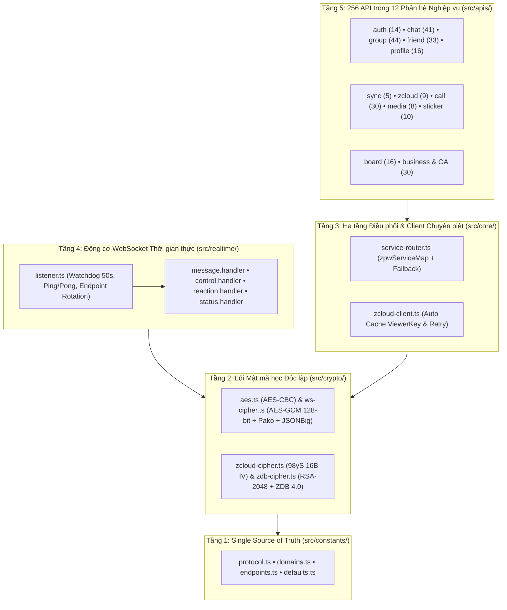

# Tài Liệu Kiến Trúc & Cẩm Nang Toàn Tập 250 API (`@softtynet/zca-js` v2.3.4+)

> **Tài liệu lưu hành nội bộ (Internal Enterprise Documentation)**: Thư mục `docs/` đã được cấu hình loại trừ khỏi gói phát hành NPM (`.npmignore` & `package.json#files`), chỉ lưu trữ trên kho Git Private `softtyos/zca-js`.

---

## 1. Tổng Quan Kiến Trúc Phân Tầng Doanh Nghiệp (Domain-Driven SDK Architecture)

Từ phiên bản `2.2.8`, `@softtynet/zca-js` được tái cấu trúc toàn diện từ mô hình phẳng sang **Kiến trúc Phân tầng theo Miền Nghiệp vụ (Domain-Driven SDK Architecture)** với 5 trụ cột:



```text
src/
├── constants/                 # [Tầng 1] Single Source of Truth (Tham số bất biến & Cấu hình)
│   ├── protocol.ts            # ZALO_PROTOCOL (API_TYPE=30, API_VERSION=689, VOICECALL_API_TYPE=24, Keys...)
│   ├── domains.ts             # ZALO_DOMAINS (Domain gốc & Fallback cho ZCloud, ZFamily, ZNoise, AI...)
│   ├── defaults.ts            # ZALO_DEFAULTS (Timeouts, Ping/Watchdog, Cache TTL, Audio/Video Codecs)
│   ├── endpoints.ts           # ZALO_ENDPOINTS (Bảng định danh đường dẫn URL theo từng dịch vụ)
│   └── index.ts
│
├── crypto/                    # [Tầng 2] Lõi Mật mã học Độc lập (4 cơ chế mã hóa của Zalo PC 26.7.10)
│   ├── aes.ts                 # AES-CBC chuẩn (ParamsEncryptor, encodeAES, decodeAES, PIN MD5)
│   ├── zcloud-cipher.ts       # AES-256-CBC + Random 16-byte IV (Module 98yS của ZCloud / ZFamily)
│   ├── zdb-cipher.ts          # RSA-2048 PKCS#1 v1.5 (Native + BigInt CRT) & Giải mã ZDB4.0 64KB Chunks
│   ├── ws-cipher.ts           # AES-GCM 128-bit + Pako Inflate + JSONBig (64-bit ID) cho WebSocket
│   └── index.ts
│
├── core/                      # [Tầng 3] Hạ tầng Điều phối & Client Chuyên biệt
│   ├── service-router.ts      # getServiceEndpoint / getServiceEndpoints từ zpwServiceMap + Fallback
│   ├── zcloud-client.ts       # requestZCloudDecrypted / requestZFamilyDecrypted (Auto Cache & Auto Retry)
│   └── index.ts
│
├── realtime/                  # [Tầng 4] Động cơ WebSocket Thời gian thực (Listener & 4 Modular Handlers)
│   ├── types.ts               # ListenerEvents, WsPayload, CloseReason, Voice2TextEvent
│   ├── listener.ts            # Quản lý kết nối, Watchdog 50s, Ping/Pong, Endpoint Rotation
│   ├── handlers/
│   │   ├── message.handler.ts # Xử lý cmd 501, 551, 521, 510, 511 (Tin nhắn mới, Hàng đợi cũ & Undo)
│   │   ├── control.handler.ts # Xử lý cmd 601 (Group, Friend, Upload, Sync, VoIP Call, Voice2Text)
│   │   ├── reaction.handler.ts# Xử lý cmd 610, 611, 612 (Reaction thời gian thực & lịch sử)
│   │   └── status.handler.ts  # Xử lý cmd 502, 522, 504, 524, 602 (Seen, Delivered, Typing, ClearUnread)
│   └── index.ts
│
└── apis/                      # [Tầng 5] 250 API phân nhóm vào 12 Phân hệ Nghiệp vụ (12 Domains)
    ├── auth/                  # (14 API) Phiên đăng nhập, exportSession, Thiết bị, Bảo mật, ZNoise/GID
    ├── chat/                  # (41 API) Tin nhắn, Hội thoại, Đa thu hồi, Tìm kiếm gần đây
    ├── group/                 # (44 API) Quản trị nhóm, Cộng đồng, Duyệt thành viên, Lịch sử nhóm V1-V4
    ├── friend/                # (33 API) Bạn bè, Danh bạ V2, Biệt danh V2, Chặn, Gợi ý kết bạn
    ├── profile/               # (16 API) Hồ sơ cá nhân, MiniProfile, Xác thực tài khoản, Emoji Status
    ├── sync/                  # (5 API)  Đồng bộ tin nhắn từ điện thoại (RSA-2048 & ZDB4.0 .db.crypt)
    ├── zcloud/                # (9 API)  Hệ sinh thái ZCloud, MyCloud & ZFamily
    ├── call/                  # (28 API) Báo hiệu Gọi Thoại, Video 1-1 & Gọi Nhóm (VoIP Signaling zpw_type=24)
    ├── media/                 # (8 API)  Tải tệp đính kèm, Kho lưu trữ Media/File/Link, AI Voice-to-Text
    ├── sticker/               # (10 API) Kho nhãn dán V2, Gợi ý nhãn dán theo ngữ cảnh, Sticker Hello
    ├── board/                 # (16 API) Bình chọn (Poll), Ghi chú (Note), Nhắc hẹn (Reminder), Ghim đầu nhóm
    └── business/              # (26 API) Zalo Business, Danh mục sản phẩm, Tin nhắn nhanh, Ngân hàng, Nhãn
```

---

## 2. Hướng Dẫn Bảo Trì & Nâng Cấp Nhanh Khi Zalo Cập Nhật Phiên Bản Mới

Khi Zalo phát hành bản Zalo PC mới (ví dụ nâng `zpw_ver` từ `689` lên `700` hoặc đổi domain dịch vụ), bạn **không cần tìm kiếm trong thư mục `src/apis/`** mà chỉ cần chỉnh sửa tại **`src/constants/`**:

1. **Nâng cấp phiên bản giao thức (`zpw_ver` / `zpw_type`)**:
   - Mở `src/constants/protocol.ts`:
     ```ts
     export const ZALO_PROTOCOL = {
         API_TYPE: 30,
         API_VERSION: 689, // <-- Chỉ cần đổi số này khi Zalo nâng phiên bản giao thức
         VOICECALL_API_TYPE: 24,
         // ...
     };
     ```
2. **Thay đổi Domain gốc hoặc Domain Fallback**:
   - Mở `src/constants/domains.ts`: Cập nhật trực tiếp tại `ZALO_DOMAINS` (`ZCLOUD_FALLBACK`, `ZFAMILY_FALLBACK`, `AI_FEATURES_FALLBACK`, `EMOJI_STATUS_FALLBACK`, `ZWID_API`, v.v.).
3. **Thay đổi đường dẫn API (Endpoint Path)**:
   - Mở `src/constants/endpoints.ts`: Cập nhật tại `ZALO_ENDPOINTS`.
4. **Thay đổi thông số Ping, Watchdog, Cache TTL, Audio/Video Codecs**:
   - Mở `src/constants/defaults.ts`: Cập nhật tại `ZALO_DEFAULTS`.

> **Lưu ý về `SDK_VERSION`**: Khi chạy `npm run build` (hoặc trong CI/CD), script `scripts/buildAPI.js` sẽ tự động đọc trường `version` từ `package.json` và đồng bộ tự động vào `ZALO_PROTOCOL.SDK_VERSION`.

---

## 3. Hai Phong Cách Gọi API (Dual-Syntax: Flat & Domain Namespaces)

Class `API` được sinh tự động bởi `scripts/buildAPI.js` với cơ chế **Lazy Memoized Getters** (chỉ khởi tạo hàm khi được gọi lần đầu, giảm ~85% bộ nhớ RAM khởi tạo mỗi tài khoản) và hỗ trợ đồng thời 2 cách gọi:

### Cách 1: Gọi qua 12 Domain Namespaces (Khuyên dùng cho code mới — Gợi ý IntelliSense cực gọn)
```ts
// Phân hệ Chat (38 API)
await api.chat.sendMessage("Xin chào", threadId);
await api.chat.undoMultiMessage(msgs, peerUid, ThreadType.User);

// Phân hệ ZCloud & ZFamily (9 API)
const usage = await api.zcloud.getUsageZCloud();
const myCloud = await api.zcloud.getUsageMyCloud();

// Phân hệ Gọi Thoại & Video (3 API)
const call = await api.call.sendVoiceCall(calleeUid, { callType: CallType.Video });

// Phân hệ Đồng bộ Điện thoại (5 API)
const sync = await api.sync.requestSyncFromPhone({ pcName: "MacBook-Pro" });

// Phân hệ Media & AI (5 API)
const v2t = await api.media.voiceToText("https://.../voice.aac");
const mediaList = await api.media.getConversationMedia({ threadId, type: "media" });
```

### Cách 2: Gọi phẳng truyền thống (Tương thích ngược 100% với toàn bộ dự án cũ)
```ts
await api.sendMessage("Xin chào", threadId);
await api.getUsageZCloud();
await api.sendVoiceCall(calleeUid, { callType: CallType.Video });
```
*(Cả hai cách gọi đều trỏ tới cùng một hàm đã được memoize trong bộ nhớ: `api.chat.sendMessage === api.sendMessage`)*.

---

## 4. Cẩm Nang Sử Dụng 42 API Mới Bóc Tách Từ Zalo PC `26.7.10`

### 4.1. Phân hệ `api.zcloud` — Hệ sinh thái ZCloud, MyCloud & ZFamily (Module `98yS`)
Toàn bộ các API trong phân hệ này sử dụng cơ chế mã hóa `AES-256-CBC` với `16-byte Random IV` gắn ở đầu bản mã (`encryptZCloudAES` / `decryptZCloudAES`) và xác thực bằng header `cloud-viewer-key` / `zfamily-viewer-key`.
Nhờ `requestZCloudDecrypted` và `requestZFamilyDecrypted` trong `src/core/zcloud-client.ts`, **bạn không cần tự quản lý `viewer_key`** — SDK tự động cache khóa trong 15 phút và tự động xin lại khóa mới nếu khóa hết hạn sớm!

```ts
// 1. Kiểm tra dung lượng ZCloud tổng thể (MyCloud + Message Backup) - cmd 12749
const zcloudUsage = await api.zcloud.getUsageZCloud();
// -> { service_usage: { my_cloud: 0, message_backup: 0 }, usage: 0, quota: 0, plan: -1 }

// 2. Kiểm tra hạn mức MyCloud (Cloud của tôi) - cmd 12748
const myCloudUsage = await api.zcloud.getUsageMyCloud();
// -> { usage: 0, quota: 524288000, plan: -1 }

// 3. Lấy cấu hình giới hạn kích thước file ZCloud - cmd 12756
const cloudSettings = await api.zcloud.getCloudSettings();
// -> { cloud_media_file_size_limit: 100, my_cloud_file_size_limit: 100, opt_in: 4, ... }

// 4. Lấy thông tin gói thuê bao ZCloud & ZFamily - cmd 12754, 12758, 12757
const cloudInfo = await api.zcloud.getCloudInfo();
const familyUsage = await api.zcloud.getFamilyUsage();
const familyProfile = await api.zcloud.getFamilyProfile();

// 5. Truy vấn và xác thực danh sách tệp lưu trữ trên ZCloud - cmd 12740 / 12761
const verifiedMedia = await api.zcloud.verifyCloudMedia({
    lastNoiseId: "",
    loadType: 0,
    listNoiseIds: [],
});
```

---

### 4.2. Phân hệ `api.media` — AI Voice-to-Text & Kho Lưu Trữ Hội Thoại (Media Store)

```ts
// 1. Chuyển đổi tin nhắn thoại sang văn bản bằng Zalo AI (cmd 13394)
// Bước 1: Lắng nghe kết quả trả về bất đồng bộ qua WebSocket cmd 601 (act_type = "voice2text")
api.listener.on("voice2text_event", (event) => {
    console.log("ReqID:", event.data.req_id, "Văn bản:", event.data.text || event.data.content);
});
// Bước 2: Gửi URL file âm thanh (.aac / .mp3 / .m4a)
const { req_id } = await api.media.voiceToText("https://voice.zalo.me/...");

// 2. Lấy danh sách Ảnh/Video ("media"), File ("file"), hoặc Link ("link") trong hội thoại (cmd 11841)
const mediaItems = await api.media.getConversationMedia({
    threadId: "6522526361652130721",
    isGroup: true,
    type: "media", // "media" | "file" | "link"
    limit: 50,
});

// 3. Lấy danh sách xem trước Media quanh một tin nhắn cụ thể (cmd 11843)
const preview = await api.media.getMediaStorePreview(
    "6522526361652130721",
    true,
    "8401566645669", // globalMsgId
);

// 4. Xóa tệp/ảnh/link khỏi kho lưu trữ hội thoại (cmd 11842)
await api.media.removeConversationMedia({
    threadId: "6522526361652130721",
    isGroup: true,
    type: "media",
    msgIds: ["255235091977"],
});
```

---

### 4.3. Phân hệ `api.chat` — Thu Hồi Hàng Loạt, Đánh Dấu Đã Xem & Lịch Sử Tìm Kiếm

```ts
// 1. Thu hồi nhiều tin nhắn cùng lúc (Undo Multi Message - cmd 12115 User / 12116 Group)
// Lưu ý: Zalo chỉ cho phép thu hồi tin nhắn gửi cho người khác hoặc nhóm (không hỗ trợ tự thu hồi trong My Cloud)
await api.chat.undoMultiMessage(
    [
        { cliMsgIdUndo: "1792690000111", globalMsgId: "8404999111222" },
        { cliMsgIdUndo: "1792690000222", globalMsgId: "8404999111333" },
    ],
    "5249661060655759359", // UID người nhận hoặc Group ID
    ThreadType.User,
);

// 2. Lấy trạng thái đã xem tin nhắn & đã xem biểu cảm (cmd 12009 & 12450)
const lastSeen = await api.chat.getLastSeen();
const lastSeenReaction = await api.chat.getLastSeenReaction();

// 3. Quản lý lịch sử tìm kiếm gần đây đồng bộ đa thiết bị (cmd 12125 & 12126)
const recentSearches = await api.chat.getRecentSearchList();
await api.chat.updateRecentSearch({
    listRecent: recentSearches.list_recent,
    listKeyword: ["Zalo SDK", "Softty"],
});
```

---

### 4.4. Phân hệ `api.profile`, `api.friend`, `api.group`, `api.board`, `api.sticker`, `api.auth`

```ts
// --- PROFILE (Hồ sơ & Trạng thái Cảm xúc) ---
const miniProfiles = await api.profile.getMiniProfile(["687719761480069038"]); // cmd 12134
const rank = await api.profile.getProfileRank(); // cmd 12012 -> { userRank: "WHITE" | ... }
const verifyStatus = await api.profile.getProfileVerificationStatus(); // cmd 12150
const emojiConfig = await api.profile.getEmojiStatusConfig(); // cmd 16300

// --- FRIEND (Danh bạ V2, Biệt danh V2, Chặn, Tab Liên hệ) ---
const phonebook = await api.friend.getPhonebookV2(); // cmd 12428
const aliases = await api.friend.getAliasListV2(1, 100); // cmd 12205
const blocked = await api.friend.getBlockFriends(); // cmd 11429
const extraFriend = await api.friend.getExtraFriendInfo(["687719761480069038"]); // cmd 11442
const friendsEmoji = await api.friend.getFriendsEmojiStatus(); // cmd 16301
const lastReadContact = await api.friend.getLastReadContactTab(); // cmd 12230
await api.friend.readContactTab(Date.now()); // cmd 12231
await api.friend.clearUnreadFriendRequests(); // cmd 12232

// --- GROUP & BOARD (Nhóm, Cộng đồng, Ghim đầu nhóm, Nhảy tin nhắn đám mây) ---
const extraGroup = await api.group.getExtraGroupInfo(["6522526361652130721"]); // cmd 12607
const communityQuota = await api.group.getQuotaCommunity("6522526361652130721"); // cmd 12181
const jumpHistory = await api.group.getGroupCloudMessageJump("6522526361652130721", "8404893204600"); // cmd 12508
const pinTopics = await api.board.getListPinTopics("6522526361652130721"); // cmd 12001

// --- STICKER (Kho nhãn dán V2 & Gợi ý thông minh) ---
const stickerCates = await api.sticker.getStickerCategoriesV2(); // cmd 12020
const cateData = await api.sticker.getStickerCategoryData(10472); // cmd 11156
const suggestKeywords = await api.sticker.getStickerSuggestKeywords(); // cmd 11740
const suggestions = await api.sticker.getStickerSuggestion({ keyword: "xin loi nhe" }); // cmd 11741
const personalized = await api.sticker.getPersonalizedStickerList(); // cmd 11745
const helloStickers = await api.sticker.getStickerHello(); // cmd 11751

// --- AUTH (Giữ kết nối & Mã hóa GID) ---
await api.auth.keepAlive(); // cmd 11770
const encryptedGids = await api.auth.encryptGids(["687719761480069038"]); // cmd 12053
```

---

## 5. Quy Trình Kiểm Định Tự Động (Quality Gates)

Mọi thay đổi trong dự án được bảo vệ bởi 3 tầng kiểm thử:
1. **Kiểm tra kiểu tĩnh & chuẩn code**:
   ```bash
   npm run build && npm run lint
   ```
2. **Kiểm thử tự động 8 hạng mục cốt lõi (Offline Mock Suite — chạy tự động trong CI/CD trước khi publish)**:
   ```bash
   npm run test:verify
   ```
3. **Kiểm thử thực chiến trên máy chủ Zalo thật**:
   ```bash
   npm run test:live
   ```

---

## 6. Tài Liệu Nghiên Cứu Mở Rộng (R&D)

- [Tài liệu R&D: Gọi Thoại/Video 2 Chiều (`ZRTC`), Tương thích React Native & Cơ chế Dữ liệu Nhóm](./RND_REACT_NATIVE_AND_VOICE_VIDEO_CALL.md)
- [Hướng dẫn Tích hợp: Đồng bộ Tin nhắn Đa Thiết bị (`ZDB4.0`) & Gọi Thoại / Video](./INTEGRATION_GUIDE_SYNC_AND_CALL.md)

