# Hướng dẫn Tích hợp: Đồng bộ Tin nhắn Đa Thiết bị (`ZDB4.0`) & Gọi Thoại / Video (`@softtynet/zca-js`)

> [!IMPORTANT]
> Tài liệu này hướng dẫn chi tiết cách tích hợp các tính năng nâng cấp của `@softtynet/zca-js` (từ phiên bản `v2.2.0+`), đã được **kiểm định thực tế 100% trên máy chủ Zalo thật và thiết bị di động thật**.

---

## 1. Tổng quan Kiến trúc

Hệ thống đồng bộ và cuộc gọi của Zalo hoạt động theo 3 luồng độc lập:

```mermaid
flowchart TD
    subgraph T1["Tầng 1: Catch-up Sync (Khi mở lại App / Mất kết nối ngắn)"]
        A1["api.chat.preloadConversations(threadIdLocalMsgId)"] --> A2["Trả về messages + pageMessages + unreadCleared (cmd 10053)"]
        A3["WebSocket: sự kiện cipher_key"] --> A4["api.listener.requestOldMessages(User / Group)"]
        A4 --> A5["Sự kiện old_messages (cmd 510 / 511) + hasMore"]
    end

    subgraph T2["Tầng 2: Mobile Backup Sync (Kéo lịch sử ZDB 4.0 từ Điện thoại)"]
        B1["api.sync.requestSyncFromPhone() (cmd 12000)"] --> B2["Điện thoại hiện thông báo xác nhận"]
        B2 --> B3["WebSocket: sync_event (user_confirm -> syncmsg_info)"]
        B3 --> B4["api.sync.getSyncData() tải file .db.crypt"]
        B4 --> B5["decryptWithPrivateKey -> deriveZdbAesKey -> decryptZdbBuffer -> parseZdbHeader"]
    end

    subgraph T3["Luồng 3: Gọi Thoại & Video (Signaling 2 bước + ZRTC)"]
        C1["api.call.sendVoiceCall(calleeId, { callType })"] --> C2["Bước 1: /api/voicecall/requestcall (cmd 11300)"]
        C2 --> C3["Bước 2: /api/voicecall/request (cmd 11301)"]
        C3 --> C4["Đổ chuông Thoại (1) hoặc Video (3) trên máy người nhận"]
        C4 --> C5["api.call.cancelVoiceCall (11305) / api.call.endVoiceCall (11306)"]
    end
```



---

## 2. Bảng tra cứu nhanh API, Sự kiện & Hàm Giải mã

### 2.1. Các phương thức trên `api` (`API` instance)

| Phương thức                                                        |    Command ID     | Endpoint Zalo                                           | Công dụng                                                                                                                                  |
| :----------------------------------------------------------------- | :---------------: | :------------------------------------------------------ | :----------------------------------------------------------------------------------------------------------------------------------------- |
| [`api.chat.preloadConversations`](./api/chat#preloadconversations) |      `10053`      | `/api/preloadconvers/get-last-msgs`                     | Lấy danh sách tin nhắn mới nhất của các hội thoại (`messages`, `msgs`, `groupMsgs`, `pageMessages`) và danh sách đã đọc (`unreadCleared`). |
| [`api.sync.requestSyncFromPhone`](./api/sync#requestsyncfromphone) |      `12000`      | `/api/message/pull_mobile_msg`                          | Tự sinh cặp khoá RSA-2048 và gửi yêu cầu đồng bộ lịch sử tin nhắn về điện thoại. Trả về `{ privateKey, publicKeyBase64, pcName }`.         |
| [`api.sync.pullMobile`](./api/sync#pullmobile)                     |      `12000`      | `/api/message/pull_mobile_msg`                          | API mức thấp để gửi yêu cầu đồng bộ với `public_key` tự quản lý.                                                                           |
| [`api.sync.cancelPullMobile`](./api/sync#cancelpullmobile)         |      `12700`      | `/api/message/cancel_pull_mobile_msg`                   | Thu hồi thông báo yêu cầu đồng bộ trên điện thoại (khi hết thời gian chờ hoặc người dùng bấm huỷ trên Web/PC).                             |
| [`api.sync.getSyncData`](./api/sync#getsyncdata)                   |         —         | _(URL động từ `syncmsg_info`)_                          | Tải gói sao lưu `.db.crypt` do điện thoại tải lên về thư mục máy chủ (`savePath`).                                                         |
| [`api.auth.getNoisedIds`](./api/auth#getnoisedids)                 |      `12390`      | `/api/znoise` _(fallback `zwid.api.zalo.me`)_           | Chuyển đổi danh sách User ID (`fids`) và Group ID (`gids`) thật sang mã ẩn danh (Noised ID) dùng trong tên file SQLite của `ZDB4.0`.       |
| [`api.auth.decryptGids`](./api/auth#decryptgids)                   |      `12054`      | `/api/gid/decrypt`                                      | Giải mã danh sách Global ID / Noised ID về ID gốc.                                                                                         |
| [`api.call.sendVoiceCall`](./api/call#sendvoicecall)               | `11300` + `11301` | `/api/voicecall/requestcall` + `/api/voicecall/request` | Khởi tạo cuộc gọi Thoại (`CallType.Audio = 1`) hoặc Video (`CallType.Video = 3`), làm đổ chuông thiết bị người nhận.                       |
| [`api.call.cancelVoiceCall`](./api/call#cancelvoicecall)           |      `11305`      | `/api/voicecall/cancel`                                 | Huỷ cuộc gọi đang đổ chuông trước khi người nhận bắt máy.                                                                                  |
| [`api.call.endVoiceCall`](./api/call#endvoicecall)                 |      `11306`      | `/api/voicecall/endcall`                                | Kết thúc cuộc gọi đang diễn ra.                                                                                                            |

### 2.2. Các sự kiện WebSocket trên `api.listener`

| Tên sự kiện      |           WebSocket `cmd`            | Tham số Callback                                             | Mô tả                                                                                                                      |
| :--------------- | :----------------------------------: | :----------------------------------------------------------- | :------------------------------------------------------------------------------------------------------------------------- |
| `old_messages`   |     `510` (User) / `511` (Group)     | `(messages: Message[], type: ThreadType, hasMore?: boolean)` | Phát ra khi nhận lô tin nhắn cũ từ hàng đợi offline của Zalo. Khi `hasMore === true`, còn tin nhắn tiếp theo cần kéo tiếp. |
| `unread_cleared` |            `504` / `524`             | `(items: ClearUnread[])`                                     | Phát ra khi người dùng đọc tin nhắn trên thiết bị khác (đồng bộ trạng thái đã đọc).                                        |
| `sync_event`     | `601` (`syncmsgmb` / `transfer_msg`) | `(event: SyncEvent)`                                         | Phát ra các trạng thái đồng bộ từ điện thoại: `user_confirm`, `syncmsg_info`, `transfer_after_login`, `transfer_error`.    |
| `call_event`     |            `601` (`voip`)            | `(event: CallEvent)`                                         | Phát ra tín hiệu cuộc gọi thời gian thực: `request`, `ringring`, `answer`, `cancel`, `endcall`, ...                        |

### 2.3. Các hàm tiện ích mật mã (`ZDB4.0` Crypto Helpers)

Được export trực tiếp từ `@softtynet/zca-js`:

- `generateRSAKeyPair()`: Sinh cặp khoá RSA-2048 (`publicKey`, `privateKey`, `publicKeyBase64`).
- `decryptWithPrivateKey(privateKeyPem, encryptedBase64)`: Giải mã `encrypted_key` bằng RSA PKCS#1 v1.5 (tự động dự phòng bằng thuật toán BigInt CRT thuần JS trên Node.js 20/22/24+).
- `deriveZdbAesKey(decryptedRsaBytes)`: Rút trích khoá AES-256 (32 bytes) từ payload RSA đã giải mã.
- `decryptZdbBuffer(encryptedBuf, aesKey)`: Giải mã toàn bộ nội dung file `.db.crypt` theo từng khối `64KB` (`0x10000` bytes) với `AES-256-CBC` và `IV = 16 bytes 0x00`.
- `parseZdbHeader(zdbPlain)`: Đọc header `"ZDB4.0"`, trích xuất danh sách toàn bộ file SQLite (`entries: [{ name, size }]`) và vị trí bắt đầu luồng nén XZ (`xzOffset`).

---

## 3. Tích hợp Tầng 1: Đồng bộ bù tin nhắn khi Offline (Catch-up Sync)

Khi ứng dụng của bạn vừa khởi động lại hoặc vừa khôi phục kết nối mạng, hãy kết hợp **2 bước**:

1. Gọi `api.preloadConversations(threadIdLocalMsgId)` qua HTTP để lấy nhanh tin nhắn cuối cùng của các hội thoại và danh sách đã đọc (`unreadCleared`).
2. Sau khi WebSocket phát sự kiện **`cipher_key`**, gọi `api.listener.requestOldMessages(...)` để kéo toàn bộ hàng đợi tin nhắn cá nhân (`cmd 510`) và nhóm (`cmd 511`). Nếu callback `old_messages` trả về `hasMore === true`, tiếp tục truyền `msgId` cuối cùng vào `requestOldMessages(type, lastMsgId)` để phân trang đến hết.

```ts
import { Zalo, ThreadType } from "@softtynet/zca-js";

const zalo = new Zalo({ selfListen: true });
const api = await zalo.login(credentials);

// Bước 1: Preload tin nhắn mới nhất & trạng thái đã đọc qua HTTP (command 10053)
// Có thể truyền map { [threadId]: lastLocalMsgId } đã lưu trong DB của bạn, hoặc bỏ trống {}
const preload = await api.preloadConversations({});

for (const msg of preload.messages) {
    console.log(`[Preload] thread=${msg.threadId} msgId=${msg.data.msgId}:`, msg.data.content);
}
for (const cleared of preload.unreadCleared) {
    console.log(
        `[Preload UnreadCleared] thread=${cleared.idTo} lastMsgId=${cleared.lastMsgId} isGroup=${cleared.isGroup}`,
    );
}

// Bước 2: Lắng nghe hàng đợi tin nhắn cũ qua WebSocket (cmd 510 & 511)
api.listener.on("old_messages", (messages, type, hasMore) => {
    console.log(
        `[OldMessages] Nhận ${messages.length} tin nhắn (${type === ThreadType.Group ? "Nhóm" : "Cá nhân"}), hasMore=${hasMore}`,
    );

    for (const msg of messages) {
        // Lưu tin nhắn vào Database của bạn (upsert theo msg.data.msgId)
    }

    // Nếu còn tin nhắn trong hàng đợi (hasMore === true), tự động kéo trang tiếp theo
    if (hasMore && messages.length > 0) {
        const lastMsgId = messages[messages.length - 1].data.msgId;
        api.listener.requestOldMessages(type, lastMsgId);
    }
});

// Đồng bộ trạng thái đã đọc thời gian thực khi bạn đọc tin nhắn trên điện thoại
api.listener.on("unread_cleared", (items) => {
    for (const item of items) {
        console.log(`[UnreadCleared] Đã đọc hội thoại ${item.idTo} tới msgId=${item.lastMsgId}`);
    }
});

// QUAN TRỌNG: Chỉ gọi requestOldMessages sau khi nhận sự kiện "cipher_key"
api.listener.on("cipher_key", () => {
    api.listener.requestOldMessages(ThreadType.User); // mặc định gửi lastId = "10000000000000000"
    api.listener.requestOldMessages(ThreadType.Group); // mặc định gửi lastId = "10000000000000000"
});

api.listener.start({ retryOnClose: true });
```

---

## 4. Tích hợp Tầng 2: Đồng bộ lịch sử sao lưu từ Điện thoại (`ZDB4.0`)

Tính năng này cho phép kéo toàn bộ lịch sử tin nhắn đang nằm trong máy điện thoại của người dùng lên Web/PC (giống hệt nút **"Đồng bộ tin nhắn"** trên Zalo PC/Web).

Có **2 kịch bản kích hoạt** đều được hỗ trợ đầy đủ:

- **Kịch bản A (Tự động sau khi quét QR)**: Nếu lúc quét mã QR trên điện thoại, người dùng tích chọn _"Đồng bộ tin nhắn"_, Zalo sẽ bắn sự kiện `SyncEventType.TRANSFER_AFTER_LOGIN` kèm `temp_key`. Bạn chỉ cần gọi `api.requestSyncFromPhone({ tempKey: event.data.temp_key })` — điện thoại sẽ tự đẩy dữ liệu lên mà không cần hỏi lại!
- **Kịch bản B (Chủ động yêu cầu bất kỳ lúc nào)**: Gọi `api.requestSyncFromPhone({ pcName: "Web" })` để làm nổ thông báo _"Xác nhận đồng bộ tin nhắn"_ trên điện thoại người dùng. Nếu sau 60 giây người dùng không bấm, gọi `api.cancelPullMobile(...)` để đóng thông báo trên điện thoại.

```ts
import fs from "node:fs";
import {
    SyncEventType,
    decryptWithPrivateKey,
    deriveZdbAesKey,
    decryptZdbBuffer,
    parseZdbHeader,
} from "@softtynet/zca-js";

let activePrivateKey = "";
let activePublicKeyBase64 = "";
let activePcName = "Web";
let confirmTimeout: ReturnType<typeof setTimeout> | null = null;

// 1. Lắng nghe toàn bộ tiến trình đồng bộ từ điện thoại qua sự kiện "sync_event"
api.listener.on("sync_event", async (event) => {
    switch (event.type) {
        // Kịch bản A: Người dùng tích chọn "Đồng bộ tin nhắn" ngay lúc quét QR
        case SyncEventType.TRANSFER_AFTER_LOGIN: {
            const session = await api.requestSyncFromPhone({
                tempKey: event.data.temp_key,
                pcName: "Web",
            });
            activePrivateKey = session.privateKey;
            activePublicKeyBase64 = session.publicKeyBase64;
            activePcName = session.pcName;
            break;
        }

        // Người dùng vừa bấm "Đồng bộ ngay" trên điện thoại (user_action === 1)
        case SyncEventType.USER_CONFIRM: {
            if (confirmTimeout) clearTimeout(confirmTimeout);
            if (event.data.user_action === 1) {
                console.log("📱 Người dùng đã xác nhận! Đang chờ điện thoại đóng gói và tải file lên...");
            } else {
                console.log("⚠️ Người dùng đã từ chối đồng bộ trên điện thoại.");
            }
            break;
        }

        // Điện thoại đã tải xong file .db.crypt lên server Zalo
        case SyncEventType.SYNCMSG_INFO: {
            if (confirmTimeout) clearTimeout(confirmTimeout);
            console.log(`📦 Gói sao lưu sẵn sàng: ${event.data.file_name} (${event.data.file_size} bytes)`);

            // Tải file .db.crypt về thư mục ./sync_data
            const dl = await api.getSyncData({
                ...event.data,
                savePath: "./sync_data",
            });

            if (dl.success && dl.data && activePrivateKey) {
                // Giải mã khoá RSA PKCS#1 v1.5 -> Rút trích khoá AES-256
                const rawRsa = decryptWithPrivateKey(activePrivateKey, dl.data.encrypted_key);
                const aesKey = deriveZdbAesKey(rawRsa);

                // Giải mã toàn bộ container ZDB4.0 (chia từng khối 64KB với IV=0)
                const cryptBytes = fs.readFileSync(dl.data.file_path);
                const zdbPlain = decryptZdbBuffer(cryptBytes, aesKey);

                // Đọc mục lục (TOC) các file SQLite hội thoại bên trong gói ZDB4.0
                const toc = parseZdbHeader(zdbPlain);
                console.log(`🎉 Giải mã thành công ${toc.entries.length} file SQLite hội thoại!`, toc.entries);

                // Lưu ý: Luồng nén XZ chứa dữ liệu của các file SQLite bắt đầu tại:
                const xzStream = zdbPlain.subarray(toc.xzOffset);
                fs.writeFileSync(`${dl.data.file_path}.xz`, xzStream);
            }
            break;
        }

        case SyncEventType.TRANSFER_ERROR: {
            console.error("❌ Lỗi đồng bộ từ điện thoại:", event.data.error_code, event.data.message);
            break;
        }
    }
});

// 2. Hàm chủ động bấm nút "Đồng bộ từ điện thoại" (Kịch bản B)
async function triggerManualPhoneSync() {
    const session = await api.requestSyncFromPhone({ pcName: "Web" });
    activePrivateKey = session.privateKey;
    activePublicKeyBase64 = session.publicKeyBase64;
    activePcName = session.pcName;

    // Tự động thu hồi thông báo trên điện thoại nếu sau 60s người dùng không bấm
    confirmTimeout = setTimeout(async () => {
        await api.cancelPullMobile({
            public_key: activePublicKeyBase64,
            pc_name: activePcName,
        });
        console.log("🧹 Đã thu hồi yêu cầu đồng bộ trên điện thoại do quá thời gian chờ.");
    }, 60_000);
}
```

---

## 5. Ánh xạ ID ẩn danh (`getNoisedIds` & `decryptGids`)

Bên trong gói sao lưu `ZDB4.0`, Zalo đặt tên các file SQLite theo mẫu:

- Tin nhắn cá nhân: `3_<myNoisedId>_<friendNoisedId>.db`
- Tin nhắn nhóm: `4_<myNoisedId>_<groupNoisedId>.db`

Để biết file `.db` nào ứng với bạn bè (`uid`) hay nhóm (`groupId`) nào, sử dụng [`api.auth.getNoisedIds`](./api/auth#getnoisedids) và [`api.auth.decryptGids`](./api/auth#decryptgids):

```ts
// 1. Đổi danh sách UID bạn bè & Group ID thật sang Noised ID
const ownId = api.getOwnId();
const friendIds = ["5249661060655759359", "6912185345590173640"];
const groupIds = ["7890123456789012345"];

const noised = await api.getNoisedIds({
    fids: [ownId, ...friendIds],
    gids: groupIds,
});

const myNoisedId = noised.fids[0];
console.log("My Noised ID:", myNoisedId);

// Map ngược từ tên file SQLite sang Friend UID thật:
const sqliteFileToFriendUid = new Map<string, string>();
friendIds.forEach((uid, index) => {
    const friendNoised = noised.fids[index + 1];
    if (friendNoised) {
        sqliteFileToFriendUid.set(`3_${myNoisedId}_${friendNoised}.db`, uid);
    }
});

// 2. Giải mã trực tiếp danh sách Global ID / Noised ID qua /api/gid/decrypt
const decrypted = await api.decryptGids(noised.fids);
console.log("Decrypted mapping:", decrypted.data ?? decrypted.gids);
```

---

## 6. Tích hợp Gọi Thoại (`CallType.Audio`) & Gọi Video (`CallType.Video`)

Thư viện hỗ trợ khởi tạo cuộc gọi 2 bước chuẩn giao thức C++ `ZaloCall` của Zalo PC:

- **`CallType.Audio = 1`**: Cuộc gọi thoại 1-1.
- **`CallType.Video = 3`**: Cuộc gọi video 1-1 (tự động đính kèm cấu hình codec H.264 `payload: 97` trong `extendData`).

### 6.1. Gọi đi (Đổ chuông Thoại hoặc Video) & Tự động huỷ khi không bắt máy

```ts
import { CallType } from "@softtynet/zca-js";

const targetUid = "5249661060655759359"; // Luôn truyền dạng chuỗi (string) 19 chữ số

// --- A. Khởi tạo Cuộc gọi VIDEO ---
const videoCall = await api.sendVoiceCall(targetUid, {
    callType: CallType.Video, // = 3
});
console.log("Đang đổ chuông Video:", {
    callId: videoCall.callId,
    sessId: videoCall.sessId,
    rtpServer: videoCall.rtpServer,
});

// Huỷ cuộc gọi Video sau 30 giây nếu người nhận chưa bắt máy
const ringTimer = setTimeout(async () => {
    await api.cancelVoiceCall(targetUid, videoCall.callId, {
        callType: CallType.Video,
    });
    console.log("Đã huỷ cuộc gọi Video do hết thời gian chờ.");
}, 30_000);

// --- B. Khởi tạo Cuộc gọi THOẠI ---
const audioCall = await api.sendVoiceCall(targetUid, {
    callType: CallType.Audio, // = 1 (mặc định)
});

// Kết thúc cuộc gọi đang diễn ra bất kỳ lúc nào
await api.endVoiceCall(targetUid, audioCall.callId);
```

### 6.2. Lắng nghe sự kiện Cuộc gọi thời gian thực (`call_event`)

```ts
import { CallEventType } from "@softtynet/zca-js";

api.listener.on("call_event", (event) => {
    console.log(`[VoIP Signal] type=${event.type}`, event.data);

    switch (event.type) {
        case CallEventType.RINGRING:
            console.log(`🔔 Máy của người nhận đã bắt đầu đổ chuông (callId=${event.data.callId})`);
            break;
        case CallEventType.ANSWER:
            console.log(`🟢 Người nhận đã bắt máy (callId=${event.data.callId})`);
            break;
        case CallEventType.CANCEL:
        case CallEventType.ENDCALL:
            console.log(`🔴 Cuộc gọi đã kết thúc hoặc bị từ chối (callId=${event.data.callId})`);
            break;
        case CallEventType.INCOMING_REQUEST:
            console.log(`📲 Có cuộc gọi đến từ UID ${event.data.callerId} (callId=${event.data.callId})`);
            break;
    }
});
```

---

## 7. Các Lưu ý Quan trọng khi Vận hành Thực tế

> [!WARNING]
> **1. Tuyệt đối giữ UID ở kiểu `string` (không ép kiểu `Number`)**
> UID của Zalo có độ dài 19 chữ số (ví dụ `"5249661060655759359"`), vượt quá giới hạn `Number.MAX_SAFE_INTEGER` (`9007199254740991`) của JavaScript. Nếu bạn ép kiểu `Number(uid)` trước khi truyền vào hàm, 3 chữ số cuối sẽ bị làm tròn thành `000` và máy chủ Zalo sẽ trả lỗi `ZaloApiError: Tham số không hợp lệ (code: 114)`.

> [!TIP]
> **2. Thời điểm gọi `requestOldMessages`**
> Luôn gọi `api.listener.requestOldMessages(...)` bên trong sự kiện `api.listener.on("cipher_key", ...)` thay vì `on("connected")`. Khi sự kiện `connected` vừa nổ, kết nối TCP/WebSocket mới thiết lập xong nhưng máy chủ Zalo chưa gửi gói `cmd=1, subCmd=1` chứa `cipher_key`.

> [!NOTE]
> **3. Kịch bản kiểm định nhanh trên máy của bạn**
> Bất kỳ lúc nào muốn kiểm tra lại toàn bộ tính năng trên tài khoản thật, bạn có thể chạy:
>
> - Kiểm định tự động (Offline/Unit): `npm run test:verify`
> - Kiểm định toàn diện trên Server thật (6 bước): `npm run test:live`
> - Chỉ test nhanh Gọi Thoại + Video tới 1 UID: `npm run test:live -- --only-call --call <UID>`
> - Chỉ test riêng Gọi Video tới 1 UID: `npm run test:live -- --only-call --video-only --call <UID>`

---

## 8. Hệ Sinh Thái 36 API Mới Bóc Tách Từ Zalo PC `26.7.10` (Đã Kiểm Định Live 100%)

Toàn bộ các API dưới đây được bóc tách từ mã nguồn Zalo PC `26.7.10` (macOS) và **đã vượt qua 100% kiểm định trực tiếp trên máy chủ Zalo thật (`error_code === 0`)**:

### 8.1. Hệ Sinh Thái ZCloud & ZFamily (Chuẩn mã hóa `98yS` — AES-256-CBC với 16-Byte Random IV)

Khác với các API thông thường dùng Zero-IV, các dịch vụ ZCloud (`zcld.chat.zalo.me`) và ZFamily (`zfml.chat.zalo.me`) sử dụng cặp khóa `{ viewer_key, enk }` từ `getCloudViewerKey()` / `getFamilyViewerKey()` và giải mã dữ liệu bằng `decryptZCloudAES(data, enk)` (tự động trích xuất 16 byte đầu của bản mã Base64 làm IV).

```ts
// 1. Lấy khóa phiên ZCloud (tùy chọn — các hàm dưới đây sẽ tự động gọi nếu không truyền vào)
const cloudKey = await api.getCloudViewerKey();

// 2. Kiểm tra dung lượng ZCloud V2, MyCloud, cài đặt ZCloud và gói Gia đình
const zcloudUsage = await api.getUsageZCloud(cloudKey);
const myCloudUsage = await api.getUsageMyCloud(cloudKey);
const cloudSettings = await api.getCloudSettings(cloudKey);
const cloudInfo = await api.getCloudInfo(cloudKey);
const familyUsage = await api.getFamilyUsage(cloudKey);
const verifyQueue = await api.verifyCloudMedia({}, cloudKey);

// 3. Lấy khóa phiên ZFamily và thông tin gói ZFamily
const familyKey = await api.getFamilyViewerKey();
const familyProfile = await api.getFamilyProfile(familyKey);
```

### 8.2. AI Voice-to-Text (`13394`) & Sự Kiện WebSocket `voice2text_event`

Chuyển đổi tin nhắn thoại sang văn bản bằng trí tuệ nhân tạo của Zalo:

```ts
// Lắng nghe kết quả nhận diện giọng nói trả về bất đồng bộ qua Control WebSocket (cmd=601)
api.listener.on("voice2text_event", (event) => {
    console.log("Hoàn tất chuyển giọng nói thành văn bản:", event.data.req_id, event.data);
});

// Gửi yêu cầu chuyển đổi URL file âm thanh (.aac / .m4a)
const { req_id } = await api.voiceToText("https://voice.chat.zalo.me/...");
```

### 8.3. Trạng Thái Cảm Xúc (Emoji Status) & Lịch Sử Tìm Kiếm Gần Đây (Recent Search)

```ts
// Lấy bộ cấu hình Emoji Status và trạng thái hiện tại của danh sách bạn bè
const emojiConfig = await api.getEmojiStatusConfig(0);
const friendsEmoji = await api.getFriendsEmojiStatus();

// Lấy và cập nhật lịch sử tìm kiếm gần đây (tự động đồng bộ version chống lỗi 160)
const recentSearch = await api.getRecentSearchList(0);
await api.updateRecentSearch({
    listRecent: recentSearch.list_recent,
    listKeyword: ["SofttyNet", "Zalo SDK"],
});
```

### 8.4. Kho Lưu Trữ Hội Thoại (Media Store — Ảnh/Video, File, Link)

> **Lưu ý quan trọng:** Máy chủ Zalo yêu cầu `mediaType` phải thuộc 1 trong 3 giá trị: `"media"` (ảnh & video), `"file"`, hoặc `"link"`.

```ts
// Lấy danh sách Ảnh/Video, File hoặc Link trong kho lưu trữ nhóm
const mediaItems = await api.getConversationMedia({
    groupId: "6522526361652130721",
    mediaType: "media", // "media" | "file" | "link"
    limit: 20,
});

// Xem trước kho lưu trữ nhóm
const preview = await api.getMediaStorePreview("6522526361652130721", ThreadType.Group, 10);

// Xóa media khỏi kho lưu trữ hội thoại
await api.removeConversationMedia({
    threadId: "6522526361652130721",
    type: ThreadType.Group,
    msgIds: ["8404893204600"],
});
```

### 8.5. Nhóm, Hồ Sơ, Danh Bạ, Tin Nhắn & Nhãn Dán Mở Rộng

| Phương thức `api.*`                                          |   Command ID    | Endpoint                                  | Công dụng                                                                      |
| :----------------------------------------------------------- | :-------------: | :---------------------------------------- | :----------------------------------------------------------------------------- |
| `api.encryptGids(uids)`                                      |     `12053`     | `/api/gid/encrypt`                        | Mã hóa danh sách UID thật sang Global/Noise ID (chiều ngược của `decryptGids`) |
| `api.getMiniProfile(friendIds)`                              |     `12134`     | `/api/social/friend/getminiprofiles`      | Lấy hồ sơ rút gọn hàng loạt của danh sách UID                                  |
| `api.getPhonebookV2(version?)`                               |     `12428`     | `/api/social/friend/phonebook/v2`         | Lấy danh bạ đồng bộ từ điện thoại (Phonebook V2)                               |
| `api.getAliasListV2(options?)`                               |     `12205`     | `/api/alias/list/v2`                      | Lấy danh sách tên gợi nhớ (Alias V2)                                           |
| `api.getBlockFriends(options?)`                              |     `11429`     | `/api/friend/blocklistv2`                 | Lấy danh sách người dùng đang bị chặn (Blocklist V2)                           |
| `api.getExtraGroupInfo(groupIds)`                            |     `12607`     | `/api/group/userctx/multiget`             | Lấy ngữ cảnh mục đích & vai trò (`purpose`, `role`) của nhiều nhóm             |
| `api.getExtraFriendInfo(friendIds)`                          |     `11442`     | `/api/friend/context/multiget`            | Lấy ngữ cảnh mục đích & vai trò (`purpose`, `role`) của nhiều bạn bè           |
| `api.getQuotaCommunity(groupId)`                             |     `12181`     | `/api/group/quota/community`              | Kiểm tra hạn mức nâng cấp Nhóm lên Cộng đồng                                   |
| `api.getProfileRank(profileId?)`                             |     `12012`     | `/api/social/profile/getrank`             | Lấy hạng tài khoản (`userRank`)                                                |
| `api.getProfileVerificationStatus()`                         |     `12150`     | `/api/social/profile/verification/status` | Kiểm tra trạng thái xác thực định danh tài khoản                               |
| `api.getLastSeen({ groupIds, userIds })`                     |     `12009`     | `/api/preloadconvers/get-last-seen`       | Lấy mốc tin nhắn đã xem cuối cùng của danh sách nhóm & cá nhân                 |
| `api.getLastSeenReaction({ groupIds, userIds })`             |     `12450`     | `/api/react/gLastSn`                      | Lấy mốc biểu cảm (reaction) đã xem cuối cùng                                   |
| `api.undoMultiMessage(items, type)`                          | `12115`/`12116` | `/api/message/multi_undo`                 | Thu hồi hàng loạt nhiều tin nhắn cá nhân hoặc nhóm cùng lúc                    |
| `api.getLastReadContactTab()`                                |     `12230`     | `/api/friend/last-read-contact-tab`       | Lấy dấu thời gian lần cuối đọc tab Danh bạ                                     |
| `api.readContactTab(ts?)`                                    |     `12231`     | `/api/friend/read-contact-tab`            | Đánh dấu đã đọc tab Danh bạ                                                    |
| `api.clearUnreadFriendRequests(uids)`                        |     `12232`     | `/api/friend/recommendsv2/read-requests`  | Đánh dấu đã xem danh sách lời mời kết bạn                                      |
| `api.getListPinTopics(groupId, ver?)`                        |     `12001`     | `/api/board/pin/list`                     | Lấy danh sách chủ đề / tin nhắn đã ghim trong nhóm                             |
| `api.getGroupCloudMessageJump(groupId, globalMsgId, count?)` |     `12508`     | `/api/cm/rgetv2`                          | Nhảy tới vị trí một tin nhắn nhóm cụ thể trên Cloud và tải ngữ cảnh xung quanh |
| `api.getStickerCategoriesV2()`                               |     `12020`     | `/api/message/sticker/category/list/v2`   | Lấy danh mục các bộ Sticker V2                                                 |
| `api.getStickerCategoryData(cid)`                            |     `11156`     | `/api/message/sticker/category/detail`    | Lấy thông tin chi tiết một bộ Sticker theo `cid`                               |
| `api.getStickerSuggestKeywords()`                            |     `11740`     | `/api/message/sticker/suggest/keywords`   | Lấy danh sách từ khóa gợi ý Sticker tự động                                    |
| `api.getStickerSuggestion(keyword)`                          |     `11741`     | `/api/message/sticker/suggest/stickers`   | Gợi ý Sticker theo từ khóa đang gõ                                             |
| `api.getPersonalizedStickerList()`                           |     `11745`     | `/api/message/sticker/personalized/list`  | Lấy danh sách Sticker cá nhân hóa                                              |
| `api.getStickerHello()`                                      |     `11751`     | `/api/message/sticker/suggestion`         | Lấy bộ Sticker chào hỏi gợi ý theo khung giờ                                   |
| `api.keepAlive()`                                            |     `11770`     | `/keepalive`                              | Gửi tín hiệu duy trì phiên kết nối HTTP tới máy chủ Chat                       |
