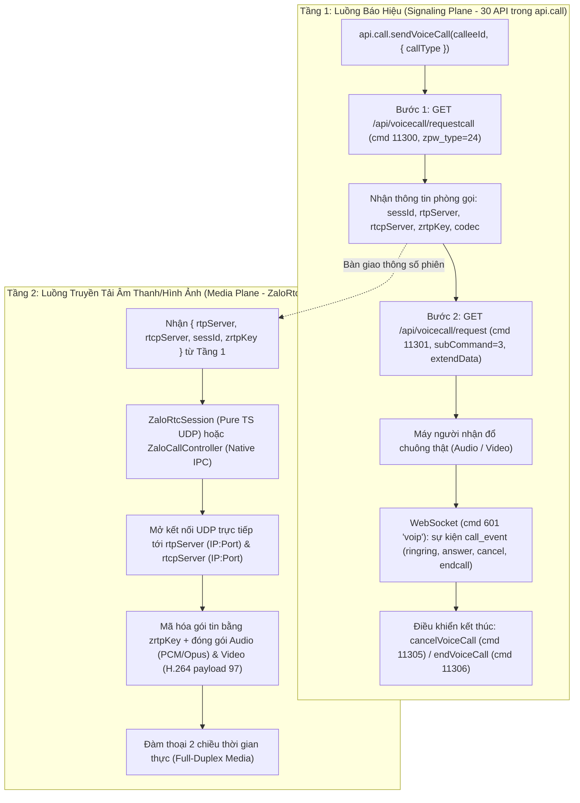

# Tài Liệu Nghiên Cứu (R&D): Gọi Thoại/Video 2 Chiều (`ZRTC`), Tương Thích React Native & Cơ Chế Dữ Liệu Nhóm (`@softtynet/zca-js` v2.3.0)

> **Tài liệu lưu hành nội bộ (Internal R&D Documentation)**: Lưu trữ trong thư mục `docs/` (đã được loại trừ khỏi gói phát hành NPM qua `.npmignore` và `package.json#files`) để phục vụ việc tra cứu, phân tích sâu và nâng cấp kiến trúc trong các giai đoạn tiếp theo.

---

## 1. Chuyên đề 1: Kiến trúc Gọi Thoại & Video (`VoiceCall Signaling` vs `ZRTC Media Engine`)

### 1.1. Tách biệt 2 tầng trong một cuộc gọi Zalo

Một cuộc gọi Thoại (`CallType.Audio = 1`) hoặc Video (`CallType.Video = 3`) trên Zalo PC (`26.7.10`) được chia thành **2 tầng hoàn toàn độc lập**:

### 1.2. Hiện trạng trong `@softtynet/zca-js` (v2.3.11+ — 30 Call APIs & Pure TypeScript `ZaloRtcSession`)

- **Tầng 1 — Complete Signaling Plane (28 APIs trong `src/apis/call/` + 2 Factory `createRtcSession`, `createController`)**:
    - **14 API Gọi 1-1 (`Commands 11300 → 11311, 12006, 12056, 12064`, `zpw_type = 24`)**:
        - `sendVoiceCall` (trọn gói `11300` + `11301`), `requestVoiceCall` (`11300` — signal `401`), `sendRequestVoiceCall` (`11301` — signal `416`), `ringRingVoiceCall` (`11302` — signal `407`), `answerVoiceCall` (`11303` — signal `402`), `answerAckVoiceCall` (`11304` — signal `408`), `cancelVoiceCall` (`11305` — signal `405`), `endVoiceCall` (`11306` — signal `404`), `holdVoiceCall` (`11307`/`11308` — signal `411`/`412`), `unholdVoiceCall` (`11309`/`11310` — signal `413`/`414`), `logEndVoiceCall` (`11311` — signal `406`), `updateCallMediaState` (`12006` — `/api/voicecall/conf`), `requestAudioToVideoCall` (`12056`), `requestShareScreenCall` (`12064`).
    - **14 API Gọi Nhóm (`Group Call Commands 12433 → 12447, 12043, 12044, 12097, 12098`, `zpw_type = 24`)**:
        - `requestGroupCall` (`12433`), `sendRequestGroupCall` (`12434`), `addUserGroupCall` (`12435`), `answerGroupCall` (`12436`), `cancelGroupCall` (`12437`), `endGroupCall` (`12438`), `ringRingGroupCall` (`12439`), `getGroupCallState` (`12445`), `finishGroupCall` (`12446`), `notifyGroupCall` (`12447`), `pingGroupCall` (`12097`), `broadcastGroupCallState` (`12098`), `joinGroupCall` (`12043`), `shareScreenGroupCall` (`12044`).
        - **Quy ước trạng thái Group Call**: `audioState = 0` (Mic Bật / Unmuted), `audioState = 1` (Mic Tắt / Muted); `videoState = 0` (Camera Bật), `videoState = 1` (Camera Tắt / Paused).
    - `src/realtime/handlers/control.handler.ts` & [`CallEvent`](./api/models#callevent): Bắt toàn bộ sự kiện `call_event` thời gian thực qua WebSocket (`request`, `ringring`, `answer`, `cancel`, `endcall`, `busy`, `hold`, `unhold`, `conf`, `audio2video`, `group_request`, `group_answer`, `group_broadcast`, `group_ping`...).

- **Tầng 2 — Pure TypeScript Media Engine (`src/call-engine/ZaloRtcSession.ts`, `ZaloSrtpSession.ts`, `ZRTPPacketCodec.ts`) — Đã Kiểm Định Thực Tế 100%**:
    - **Giao thức UDP `ZRTPPacket` & `SRTP AES-CM-128-HMAC-SHA1-80`**:
        - Cuộc gọi 1-1: Bắt tay `Echo (cmd=248)` $\rightarrow$ `InitCall (cmd=1)` $\rightarrow$ `RelayPing (cmd=243)` / `Ping (cmd=2)`. Hỗ trợทั้ง Legacy framing (`packetMode=1`: `0x03/0x04/0x05/0x0d/0x0e/0x0f`) và Multiplexed ZRTC framing (`packetMode=2`: `0x7f` 9-byte header).
        - Cuộc gọi nhóm (Zavi SFU): Luôn dùng `packetMode=1` (5-byte prefix khi gửi, 1-byte `0x04`/`0x0e` khi nhận). Bắt tay `Echo (cmd=248)` $\rightarrow$ `InitZaviPing (cmd=53)` $\rightarrow$ nhận `ZaviRoomUpdated (cmd=50)`, gửi `RequestForward` (`subCmd=2` AudioCodecList, `subCmd=11` VideoQualityBitrateConfig, `subCmd=13` VideoQualityRequest) và `AudioCodec (cmd=19, codecType=9 khi tắt Mic)`.
    - **Đóng gói RTP Video H.264 Annex-B FU-A (`0x1c`, `origNalType=0`) & `0xBEDE` 24-Byte Header Extension**:
        - Sử dụng H.264 Constrained Baseline Profile Level 3.0 (`avc1.42001e`), các gói lớn (`> 1135B`) được phân mảnh với `fuIndicator = 0x1c` (`type=28`), `fuHeader = 0x80` (Start) / `0x00` (Middle) / `0x40` (End), giữ nguyên Annex-B start code `00 00 00 01` ở đầu mảnh Start để tương thích với `VCMPacket::CopyCodecSpecifics` của Zalo Mobile/PC.
        - Trong Group Call, mỗi gói RTP Video đính kèm **24-byte RFC 5285 One-Byte Extension (`0xBEDE`, `length=5` words)**: `0x32` (`id=3, L=2` AbsSendTime) + `0x51` (`id=5, L=1` TransportSeq) + `0xc2` (`id=12, L=2` VideoGroupCall) + `0xd6` (`id=13, L=6` CaptureNtpTime) + `0x00` (padding).
        - Khi nhận RTP Video từ Zavi SFU (`SSRC = 1`), động cơ tự động đọc `CSRC[0]` (offset 12..15) để lấy 32-bit VoIP UID của thành viên phát và ánh xạ sang Zalo UID 19 chữ số (`frame.partnerId`), đồng thời khử trùng lặp gói RTP theo `(sequenceNumber, timestamp)`.

### 1.3. Ứng dụng thực tế của bộ API Call hiện tại

1. **Nháy máy / Báo thức thông báo (Wake-up / Buzz)**:
    - Khi gửi tin nhắn quan trọng mà khách hàng chưa đọc, gọi `api.call.sendVoiceCall(uid, { callType: CallType.Audio })` để làm sáng màn hình và đổ chuông điện thoại người nhận trong 5–10 giây, sau đó gọi `api.call.cancelVoiceCall(uid, callId)`.
2. **Tổng đài thông báo & Tự động phản hồi khi có cuộc gọi đến**:
    - Lắng nghe `api.listener.on("call_event", ...)` để phát hiện ngay khi khách hàng bấm gọi vào tài khoản Zalo:
        - Hiển thị cảnh báo cuộc gọi đến theo thời gian thực trên màn hình CRM/App của nhân viên.
        - Hoặc tự động từ chối cuộc gọi (`endVoiceCall` / `cancelVoiceCall`) kèm gửi ngay một tin nhắn văn bản hoặc tin nhắn thoại (`api.chat.sendVoice`) hướng dẫn khách hàng để lại lời nhắn.
3. **Giao tiếp giọng nói 2 chiều qua Tin nhắn thoại (`sendVoice` + `voiceToText`)**:
    - Nhân viên thu âm trên App/Web và gửi qua [`api.chat.sendVoice`](./api/chat#sendvoice), đồng thời dùng [`api.media.voiceToText`](./api/media#voicetotext) để tự động chuyển tin nhắn thoại của khách thành văn bản.

### 1.4. Hướng nghiên cứu tiếp theo (R&D Roadmap cho Đàm thoại 2 chiều)

Khi cần nghiên cứu sâu hơn để giải bài toán truyền âm thanh 2 chiều trong tương lai, các bước R&D cần thực hiện gồm:

1. **Phân tích cầu nối IPC giữa JS và Native Engine trong Zalo PC (`26.7.10`)**:
    - Tìm kiếm các lời gọi IPC liên quan đến `voip`, `zrtc`, `startCall`, `rtpServer`, `zrtpKey` trong `main-dist` và `pc-dist` của `/Applications/Zalo.app/Contents/Resources/app.asar`.
2. **Phân tích Native Binary trong bộ cài Zalo.app**:
    - Kiểm tra các thư viện động (`.node`, `.dylib`, `.framework`) đi kèm trong `/Applications/Zalo.app/Contents/Frameworks` để xác định xem Zalo PC nạp module ZRTC qua Electron Node Addon hay Process riêng.
    - Nếu là Node Native Addon (`.node`), có thể nghiên cứu nạp trực tiếp addon đó từ tiến trình Node.js/Electron trên cùng hệ điều hành để đẩy luồng PCM/Opus vào phiên gọi.
3. **Phân tích cấu trúc gói tin UDP RTP/RTCP (`Wireshark` / `tcpdump`)**:
    - Bắt gói tin UDP gửi tới `rtpServer` và `rtcpServer` trong một cuộc gọi thật trên Zalo PC để đối chiếu header RTP, payload type (Opus / H.264 payload `97`) và cách `zrtpKey` được dùng để mã hóa SRTP/ZRTP.

---

## 2. Chuyên đề 2: Phân tích Chạy Trực Tiếp trên React Native vs Đặt trên Server Gateway

### 2.1. Đánh giá khả năng chạy trực tiếp `@softtynet/zca-js` trên React Native

- **Về mặt Giao thức mạng (Network Protocol)**:
    - 99% các API của thư viện là mã hóa AES-CBC (`crypto-js`) + gửi HTTP `fetch` + nhận sự kiện WebSocket.
    - Môi trường React Native **không bị chặn CORS** như trình duyệt Web, nên hoàn toàn gửi được các request tới `*.zalo.me` từ thiết bị di động.
- **5 điểm phụ thuộc vào Node.js cần xử lý nếu muốn bundle trực tiếp vào React Native (Metro / Hermes)**:

| STT | Module / Thư viện          | Vị trí trong Codebase                                                                                                                | Vấn đề trên React Native                                                                                      | Hướng xử lý (Khi cần làm bản Universal)                                                                                                                                                      |
| :-: | :------------------------- | :----------------------------------------------------------------------------------------------------------------------------------- | :------------------------------------------------------------------------------------------------------------ | :------------------------------------------------------------------------------------------------------------------------------------------------------------------------------------------- |
|  1  | `node:fs`, `node:path`     | `src/utils.ts`, `src/zalo.ts`, [`api.auth.getQR`](./api/auth#getqr)                                                                  | Metro Bundler không có sẵn module `node:fs` và `node:path`.                                                   | Chuyển sang nạp động (`await import("node:fs")`) chỉ khi truyền đường dẫn file trên Node, còn trên Mobile truyền trực tiếp `Uint8Array` / `ArrayBuffer`.                                     |
|  2  | `ws` (Node WebSocket)      | `src/realtime/listener.ts`                                                                                                           | Gói `ws` phụ thuộc `node:net`, `node:tls`, `node:http`.                                                       | Kiểm tra nếu môi trường có `globalThis.WebSocket` (React Native hỗ trợ truyền `{ headers }` ở tham số thứ 3: `new WebSocket(url, undefined, { headers })`) thì dùng trực tiếp thay cho `ws`. |
|  3  | `node:crypto` & `Buffer`   | `src/crypto/ws-cipher.ts`, `src/crypto/zdb-cipher.ts`, `src/crypto/zcloud-cipher.ts`                                                 | Giải mã WebSocket (`AES-GCM`), ZCloud (`AES-256-CBC`) và ZDB (`RSA-2048`) đang gọi `node:crypto` và `Buffer`. | Chuyển `zcloud-cipher` sang dùng `crypto-js` / `Uint8Array`, và hỗ trợ polyfill `react-native-quick-crypto` + `buffer` (hoặc WebCrypto API).                                                 |
|  4  | `form-data` (Node Stream)  | [`api.media.uploadAttachment`](./api/media#uploadattachment), [`api.profile.changeAccountAvatar`](./api/profile#changeaccountavatar) | Dùng Node `stream` không chạy trên Hermes.                                                                    | Sử dụng chuẩn `FormData` / `Blob` / `Uint8Array` đa nền tảng.                                                                                                                                |
|  5  | Quản lý Cookie của `fetch` | `src/utils.ts` (`request()`)                                                                                                         | `fetch` trên iOS (`NSHTTPCookieStorage`) và Android (`OkHttp`) tự động can thiệp vào header `Cookie`.         | Bổ sung `credentials: "omit"` vào `fetch` options để `tough-cookie` kiểm soát hoàn toàn header `cookie` trên mọi nền tảng.                                                                   |

### 2.2. So sánh Kiến trúc: Đặt trên Server Gateway vs Chạy trực tiếp trên App React Native

| Tiêu chí                                       | Phương án 1: Đặt SDK trên Server (Node.js/Bun), App RN gọi qua Server                                                                                   | Phương án 2: Nhúng trực tiếp SDK vào App React Native                                                                           |
| :--------------------------------------------- | :------------------------------------------------------------------------------------------------------------------------------------------------------ | :------------------------------------------------------------------------------------------------------------------------------ |
| **Độ trễ (Latency)**                           | Rất thấp (~15ms – 40ms cho mỗi lệnh API/Signaling). Không gây cảm giác trễ.                                                                             | Gọi thẳng từ điện thoại tới máy chủ Zalo.                                                                                       |
| **Giữ kết nối WebSocket (`Listener`)**         | **Ổn định 24/7**. Server luôn giữ kết nối nhận tin nhắn ngay cả khi người dùng tắt màn hình điện thoại, sau đó bắn Push Notification (FCM/APNs) về App. | Khi người dùng tắt màn hình hoặc vuốt App xuống Background, iOS/Android sẽ ngắt WebSocket sau ~30 giây.                         |
| **Độ ổn định Phiên đăng nhập (`Cookie` / IP)** | **Rất cao**. Phiên `API_TYPE = 30` (Zalo PC/Web) giữ nguyên 1 địa chỉ IP cố định trên Server.                                                           | Khi điện thoại di chuyển đổi từ WiFi sang 4G/5G liên tục, IP của phiên `API_TYPE = 30` thay đổi liên tục.                       |
| **Đồng bộ nhiều nhân viên (Multi-Agent CRM)**  | Nhiều máy điện thoại / trình duyệt cùng thao tác trên 1 tài khoản Zalo thông qua Server mà không bị đá văng phiên của nhau.                             | Mỗi máy tự giữ kết nối riêng (chỉ có 1 kết nối WebSocket `enable_encrypt` hoạt động tại 1 thời điểm trên cùng `API_TYPE = 30`). |
| **Chi phí hạ tầng Server**                     | Cần Server duy trì kết nối và băng thông nếu tải nhiều file lớn.                                                                                        | Tận dụng trực tiếp mạng 4G/WiFi và IP của từng máy điện thoại người dùng.                                                       |

> **Kết luận kiến trúc**:
>
> - Nếu làm **Hệ thống quản lý tập trung / CRM / Chatbot / Nhận tin nhắn ngầm 24/7 có Push Notification**: Nên đặt `@softtynet/zca-js` trên **Server Node.js/Bun** (Phương án 1).
> - Nếu làm **Công cụ chạy theo phiên khi người dùng mở App (Foreground Utility)** để tận dụng IP của chính điện thoại người dùng: Có thể nâng cấp lớp Adapter để chạy trực tiếp trên **React Native** (Phương án 2).

---

## 3. Chuyên đề 3: Kiến trúc Phân quyền Danh sách Thành viên Nhóm & Cộng đồng (`lockViewMember`)

### 3.1. Các Endpoint Thông tin Nhóm trong Zalo PC (`26.7.10`)

Trong mã nguồn Zalo PC hiện có 4 endpoint truy vấn thông tin và thành viên nhóm:

1. [`getGroupInfo`](./api/group#getgroupinfo) (`/api/group/getmg-v2` — `cmd 12028`):
    - Nhận `gridVerMap: { [groupId]: 0 }`.
    - Trả về `gridInfoMap[groupId]` chứa `memVerList` (`["<uid>_<ver>", ...]`), `adminIds`, `creatorId`, `totalMember`, `setting`.
2. [`getGroupLinkInfo`](./api/group#getgrouplinkinfo) (`/api/group/link/ginfo` — `cmd 11824`):
    - Nhận `{ link, avatar_size: 120, member_avatar_size: 120, mpage }`.
    - Trả về `currentMems` (phân trang theo `mpage`), `hasMoreMember`, `adminIds`, `creatorId`, `totalMember`, `setting`.
3. `getGroupInfos` (`/api/group/getmg` — `cmd 12604`):
    - Nhận `{ grids, avatar_size: 120, member_avatar_size: 120, mpage, mcount }`.
4. [`getGroupInfoV2`](./api/group#getgroupinfov2) (`/api/group/getgi/v2` & `/api/group/getgi` — `cmd 11162`):
    - Nhận `{ grid, avatar_size: 120, member_avatar_size: 120, mpage, mcount: 100 }`.

### 3.2. Cơ chế kiểm soát `setting.lockViewMember` tại Backend Zalo

- **Khi `setting.lockViewMember === 0` (Nhóm thông thường hoặc Cộng đồng không khóa danh sách thành viên)**:
    - `getGroupInfo` trả về toàn bộ danh sách `memVerList`.
    - `getGroupLinkInfo` cho phép phân trang qua tham số `memberPage` (`mpage = 1, 2, 3...`) cho đến khi `hasMoreMember === 0`.
- **Khi `setting.lockViewMember === 1` (Cộng đồng bật _"Chỉ trưởng/phó cộng đồng được xem danh sách thành viên"_)**:
    - Máy chủ Zalo kiểm tra `uid` của phiên gọi API:
        - Nếu `uid` là **Trưởng nhóm (`creatorId`)** hoặc **Phó nhóm (`adminIds`)**: Server trả về đầy đủ 100% danh sách thành viên trong `memVerList` / `currentMems`.
        - Nếu `uid` là **Thành viên thường**: Server lọc danh sách ngay tại tầng Backend, chỉ trả về ID của ban quản trị (`creatorId`, `adminIds`) và chính `uid` đang gọi API.

### 3.3. Cấu trúc các API dữ liệu hoạt động trong nhóm có sẵn trong SDK

Các dữ liệu tương tác phát sinh bên trong nhóm được quản lý qua các phân hệ độc lập trong SDK:

- **Lịch sử tin nhắn & Sự kiện nhóm**: [`api.group.getGroupChatHistory`](./api/group#getgroupchathistory) (`/api/cm/getrecentv2`) và [`api.group.getGroupCloudMessageJump`](./api/group#getgroupcloudmessagejump) (`/api/cm/getjumpv2` — `cmd 12508`).
- **Kho lưu trữ Media / File / Link của nhóm**: [`api.media.getConversationMedia`](./api/media#getconversationmedia) (`/api/mediastore/list` — `cmd 11841`, hỗ trợ `mediaType: "media" | "file" | "link"`).
- **Bảng tin nhóm (Ghi chú, Bình chọn, Nhắc hẹn)**:
    - [`api.board.getListBoard`](./api/board#getlistboard) (`/api/board/list` — `cmd 12140`)
    - [`api.board.getPollDetail`](./api/board#getpolldetail) (`/api/poll/detail` — `cmd 12081`)
    - [`api.board.getReminderResponses`](./api/board#getreminderresponses) (`/api/board/topic/listResponseEvent`)
- **Tra cứu hồ sơ thành viên theo danh sách UID**: [`api.group.getGroupMembersInfo`](./api/group#getgroupmembersinfo) (`/api/social/group/members`).
