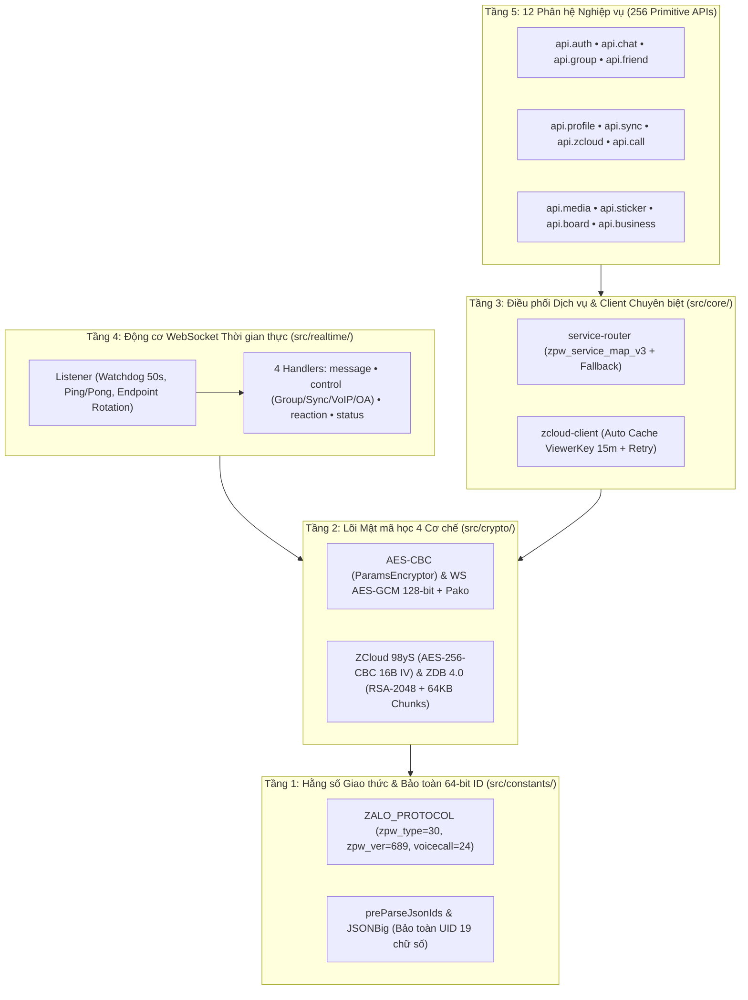

# Kiến trúc SDK & Cơ chế Giải mã Lõi

## 1. Sơ đồ Tổng quan Kiến trúc 5 Tầng (`@softtynet/zca-js`)

## 2. Kiến trúc 12 Domains (Lazy Memoized Getters)

`@softtynet/zca-js` tự động ánh xạ toàn bộ các API nguyên bản vào 12 phân hệ trên đối tượng `api`:

- `api.auth`: Xác thực, QR, phiên đăng nhập (`exportSession`), giải mã `globalId` (`encryptGids` / `decryptGids`) & `getNoisedIds`.
- `api.chat`: Tin nhắn 1-1, nhóm & Zalo OA (`preloadConversations`), thu hồi đơn/đa tin nhắn (`undoMultiMessage`), hội thoại ghim/ẩn/lưu trữ.
- `api.group`: Quản lý nhóm/Cộng đồng, lịch sử Cloud (`getGroupChatHistory`, `getGroupCloudMessagePath`), trạng thái đã xem (`getGroupMessageStatus`).
- `api.friend`: Bạn bè, danh bạ V2 (`getPhonebookV2`), biệt danh V2 (`getAliasListV2`), kiểm tra online PC/Web (`getFriendsActivePCWeb`).
- `api.profile`: Hồ sơ cá nhân, Emoji Status, xác thực tài khoản.
- `api.sync`: Đồng bộ lịch sử tin nhắn từ Mobile (`requestSyncFromPhone`, `pullMobile`, `getSyncData`).
- `api.zcloud`: ZCloud & ZFamily (`getCloudViewerKey`, `getUsageZCloud`, `verifyCloudMedia`).
- `api.call`: Gọi thoại, Video 1-1 & Gọi nhóm — trọn bộ 30 API (`sendVoiceCall`, `requestVoiceCall`, `sendRequestVoiceCall`, `ringRingVoiceCall`, `answerVoiceCall`, `answerAckVoiceCall`, `cancelVoiceCall`, `endVoiceCall`, `holdVoiceCall`, `unholdVoiceCall`, `logEndVoiceCall`, `updateCallMediaState`, `requestAudioToVideoCall`, `requestShareScreenCall`, 14 API `*GroupCall*`, `createRtcSession`, `createController`).
- `api.media`: Kho lưu trữ Media/File/Link nhóm & cá nhân (`getConversationMedia`, `getMediaStorePreview`, `getPersonalMedia`), `voiceToText`.
- `api.sticker`: Nhãn dán, danh mục V2, gợi ý nhãn dán theo từ khóa.
- `api.board`: Bảng tin nhóm, Tin ghim (`getListPinTopics`), Bình chọn (`getPollDetail`), Lịch hẹn (`getListReminder`).
- `api.business`: Zalo Official Account (`getOAProfile`, `blockOA`, `unblockOA`, `convertOAIds`), Nhãn hội thoại (`getLabels`), Tin nhắn nhanh, Trả lời tự động, Danh mục sản phẩm.

## 3. Cơ chế Bảo toàn Số nguyên 64-bit (`preParseJsonIds`)

Nhiều API của Zalo (như `/api/mediastore/list` và `/api/mediastore/preview`) trả về UID 19 chữ số dưới dạng **JSON Number không có dấu ngoặc kép** (ví dụ `"owner_id": 4829384719283746192`).

Nếu gọi trực tiếp `JSON.parse()`, JavaScript (IEEE-754 double) sẽ làm tròn mất 3 chữ số cuối khi vượt quá `Number.MAX_SAFE_INTEGER` (`9007199254740991`).

`@softtynet/zca-js` tích hợp sẵn hàm `preParseJsonIds` ngay trong tầng `handleZaloResponse` trước khi `JSON.parse()` (giống cơ chế `preParse` trong `app.asar` của Zalo PC), giúp tự động chuyển các trường ID 16+ chữ số (`owner_id`, `group_id`, `uidFrom`, `idTo`, `globalMsgId`, `cliMsgId`...) sang kiểu `string` chính xác tuyệt đối.
