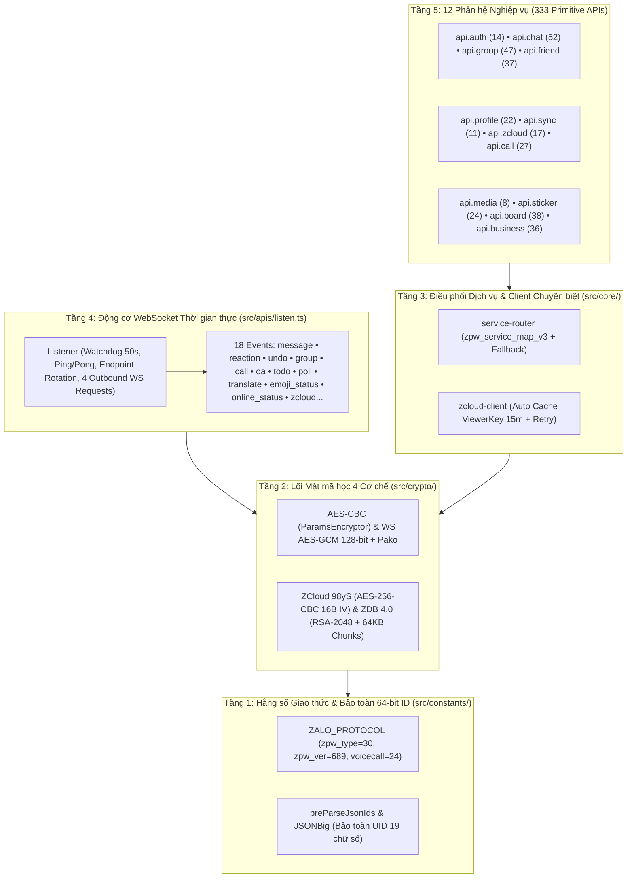

# Kiến trúc SDK & Cơ chế Giải mã Lõi

## 1. Sơ đồ Tổng quan Kiến trúc 5 Tầng (`@softtynet/zca-js`)

## 2. Kiến trúc 12 Domains (333 APIs — Lazy Memoized Getters)

`@softtynet/zca-js` tự động ánh xạ toàn bộ **333 API nguyên bản** vào **12 phân hệ** trên đối tượng `api` (đồng thời vẫn giữ nguyên alias gọi phẳng `api.<methodName>()` để tương thích ngược 100%):

- **`api.auth` (`14 API`)**: Xác thực, QR, phiên đăng nhập (`exportSession`), danh sách thiết bị (`getListDevice`), giải mã `globalId` (`encryptGids` / `decryptGids`) & `getNoisedIds`.
- **`api.chat` (`52 API`)**: Tin nhắn 1-1, nhóm & Zalo OA (`preloadConversations`), dịch tự động bằng Zalo AI (`translateMessage`, `translateMessageAuto`, `translateMessageSuggest`, `getTranslateSetting`, `updateTranslateSetting`), chặn chia sẻ (`getBlockSharingConversations`, `updateBlockSharingConversation`), tải tin nhắn quan trọng (`fetchImportantMessages`), gia hạn link tệp (`renewMessageLink`), thu hồi đơn/đa tin nhắn (`undoMultiMessage`), hội thoại ghim/ẩn/lưu trữ.
- **`api.group` (`47 API`)**: Quản lý nhóm/Cộng đồng (`getGroupInfoV2`, `getGroupListV3`, `checkQuotaCommunityMember`, `analyseGroup`, `getE2eeGroupList`), lịch sử Cloud (`getGroupChatHistory`, `getGroupCloudMessagePath`), trạng thái đã xem (`getGroupMessageStatus`).
- **`api.friend` (`37 API`)**: Bạn bè, danh bạ V2 (`getPhonebookV2`), biệt danh V2 (`getAliasListV2`), kiểm tra online PC/Web (`getFriendsActivePCWeb`), lấy mã QR hàng loạt (`getMultiUserQRCodes`), xóa gợi ý kết bạn V2 (`removeFriendRecommendationV2`), trạng thái tab danh bạ (`getLastReadContactTab`, `readContactTab`).
- **`api.profile` (`22 API`)**: Hồ sơ cá nhân, hồ sơ thu gọn (`getMiniProfile`), thông tin mở rộng (`getProfileExtra`), hồ sơ doanh nghiệp (`getEnterpriseProfiles`), trạng thái xác thực EKYC (`getProfileVerificationStatus`, `pushProfileVerificationMessage`), đăng ký dùng thử Business (`registerTrialBizAccount`), Emoji Status (`getEmojiStatusConfig`).
- **`api.sync` (`11 API`)**: Đồng bộ lịch sử tin nhắn từ Mobile (`requestSyncFromPhone`, `pullMobile`, `cancelPullMobile`, `deleteMobileMsgSnapshot`, `getSyncData`), thông tin sao lưu (`getBackupMsgInfo`, `getCrossDbInfo`), đồng bộ hành động Media (`submitSyncMediaActions`) & tải lên gói sao lưu (`uploadBackupChunk`).
- **`api.zcloud` (`17 API`)**: ZCloud & ZFamily (`getCloudViewerKey`, `getFamilyViewerKey`, `getUsageZCloud`, `getUsageMyCloud`, `getCloudInfo`, `getCloudSettings`, `verifyCloudMedia`, `getCloudDownloadUrls`, `resetCloudQueue`, `submitCloudMediaExtInfo`, `ackCloudOnboarding`, `submitCloudVerifyAction`, `getCloudUploadUrl`, `migrateCloudRecent`).
- **`api.call` (`27 API`)**: Gọi thoại, Video 1-1 & Gọi nhóm — trọn bộ API báo hiệu (`sendVoiceCall`, `requestVoiceCall`, `sendRequestVoiceCall`, `ringRingVoiceCall`, `answerVoiceCall`, `answerAckVoiceCall`, `cancelVoiceCall`, `endVoiceCall`, `holdVoiceCall`, `unholdVoiceCall`, `logEndVoiceCall`, `updateCallMediaState`, `requestAudioToVideoCall`, `requestShareScreenCall`, 11 API `*GroupCall*`) cùng 2 bộ máy điều khiển truyền tải `createRtcSession` & `createController`.
- **`api.media` (`8 API`)**: Kho lưu trữ Media/File/Link nhóm & cá nhân (`getConversationMedia`, `getMediaStorePreview`, `getPersonalMedia`, `removeConversationMedia`, `removePersonalMedia`), `uploadAttachment` & `voiceToText`.
- **`api.sticker` (`24 API`)**: Nhãn dán, danh mục V2, gợi ý nhãn dán theo từ khóa, nhãn dán cá nhân hóa (`getPersonalizedStickerList`, `updatePersonalizedStickerList`), hiệu ứng tin nhắn (`getMessageEffects`, `getMessageEffectById`), ánh xạ Tenor (`getTenorStickerMapping`), ảnh động Guggy (`getDefaultGuggyGifs`, `searchGuggyGifs`) và kho GIF Giphy (`getGifCategories`, `getGifsByCategory`, `getTrendingGifs`, `searchGifs`, `getGifDictionaries`, `getGifsByDictionary`).
- **`api.board` (`38 API`)**: Công việc Zalo To-Do (`createTodo`, `updateTodo`, `deleteTodo`, `getTodoList`, `getTodoDetail`, `updateTodoStatus`, `dingTodo`, `ackDingTodo`, `verifyTodo`), Bảng tin & Nhắc hẹn 1-1 (`createOneOneBoardTopic`, `updateOneOneBoardTopic`, `removeOneOneBoardTopic`, `getListOneOneBoard`), Ghim hội thoại bạn bè (`pinFriendMessage`, `reorderFriendBoard`, `unpinFriendMessages`), Tin ghim nhóm (`getListPinTopics`, `pinBoardTopic`, `unpinBoardTopic`, `multiUnpinBoardTopics`, `reorderPinTopics`, `removeBoardTopic`), Bình chọn (`createPoll`, `getPollDetail`, `votePoll`, `addPollOptions`, `sharePoll`, `lockPoll`), Ghi chú & Lịch hẹn nhóm (`createNote`, `editNote`, `createReminder`, `editReminder`, `getReminder`, `getListReminder`, `removeReminder`, `respondReminder`, `getReminderResponses`).
- **`api.business` (`36 API`)**: Zalo Official Account (`getOAProfile`, `blockOA`, `unblockOA`, `convertOAIds`), Quản lý Nhãn phân loại CRM (`getLabels`, `updateLabels`, `addConversationLabel`, `updateConversationLabelItem`, `deleteConversationLabel`, `reorderConversationLabels`), Tin nhắn nhanh (`getQuickMessageList`, `addQuickMessage`, `updateQuickMessage`, `removeQuickMessage`), Trả lời tự động (`getAutoReplyList`, `createAutoReply`, `updateAutoReply`, `deleteAutoReply`), Danh mục & Sản phẩm (`getCatalogList`, `createCatalog`, `updateCatalog`, `deleteCatalog`, `getProductCatalogList`, `getProductDetail`, `createProductCatalog`, `updateProductCatalog`, `deleteProductCatalog`, `deleteSingleProduct`, `uploadProductPhoto`) & Ngân hàng (`getListBank`, `getListBankAccount`, `createBankAccount`, `updateBankAccount`, `deleteBankAccount`).

## 3. Cơ chế Bảo toàn Số nguyên 64-bit (`preParseJsonIds`)

Nhiều API của Zalo (như `/api/mediastore/list` và `/api/mediastore/preview`) trả về UID 19 chữ số dưới dạng **JSON Number không có dấu ngoặc kép** (ví dụ `"owner_id": 4829384719283746192`).

Nếu gọi trực tiếp `JSON.parse()`, JavaScript (IEEE-754 double) sẽ làm tròn mất 3 chữ số cuối khi vượt quá `Number.MAX_SAFE_INTEGER` (`9007199254740991`).

`@softtynet/zca-js` tích hợp sẵn hàm `preParseJsonIds` ngay trong tầng `handleZaloResponse` trước khi `JSON.parse()` (giống cơ chế `preParse` trong `app.asar` của Zalo PC), giúp tự động chuyển các trường ID 16+ chữ số (`owner_id`, `group_id`, `uidFrom`, `idTo`, `globalMsgId`, `cliMsgId`...) sang kiểu `string` chính xác tuyệt đối.
