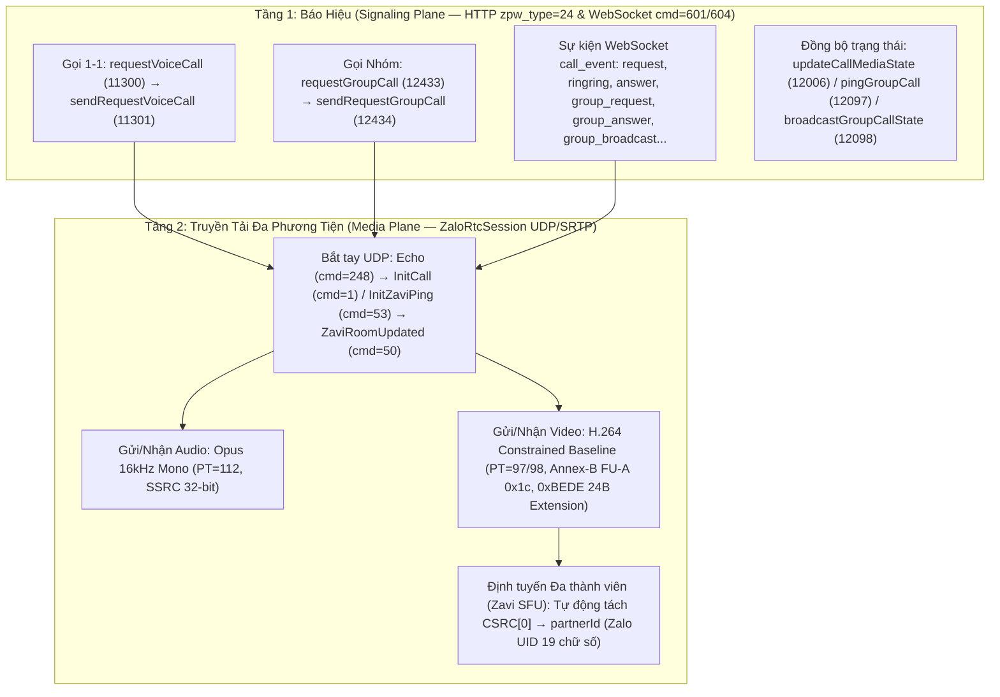

# 📞 Hướng dẫn Gọi Thoại, Video 1-1 & Gọi Nhóm 2 Chiều (`ZaloRtcSession`)

Bộ SDK **`@softtynet/zca-js`** cung cấp trọn vẹn **30 API trong phân hệ `api.call`** kết hợp cùng động cơ truyền tải thời gian thực thuần TypeScript **[`ZaloRtcSession`](../api/call.md#creatertcsession)** (UDP `ZRTPPacket` + `SRTP AES-CM-128-HMAC-SHA1-80` + `Opus 16kHz` + `H.264 Annex-B FU-A`), hoạt động độc lập trên **Node.js / Bun / Electron / Server Gateway** mà không phụ thuộc vào ứng dụng Zalo PC.

---

## 1. Tổng quan Kiến trúc 2 Tầng (Signaling & Media Plane)



---

## 2. Khởi tạo `ZaloRtcSession` & Các Sự kiện Cốt lõi

Sử dụng `api.call.createRtcSession()` để tạo một phiên điều khiển cuộc gọi (hỗ trợ tái sử dụng cho nhiều cuộc gọi liên tiếp trên cùng một instance):

```ts
import { Zalo, CallType } from "@softtynet/zca-js";

const zalo = new Zalo({ selfListen: true });
const api = await zalo.login(savedSession);
api.listener.start({ retryOnClose: true });

const session = api.call.createRtcSession({
    autoAttachListener: true, // Tự động lắng nghe sự kiện call_event từ api.listener
    autoKeepaliveMedia: true, // Tự động gửi gói giữ kết nối UDP/RTP & RTCP Receiver Report
});

// 1. Theo dõi thay đổi trạng thái cuộc gọi:
// "idle" | "allocating" | "handshaking_udp" | "inviting" | "ringing" | "answering" | "active" | "ending" | "ended"
session.on("state", (state) => {
    console.log(`[Call State] -> ${state}`);
});

// 2. Nhận khung âm thanh Opus giải mã từ đối phương hoặc thành viên nhóm
session.on("audio_frame", (frame) => {
    // frame.payload: Buffer (Opus 16kHz Mono, 20ms/40ms)
    // frame.ssrc: number (32-bit VoIP UID của người nói)
    // frame.sequenceNumber, frame.timestamp
});

// 3. Nhận khung hình H.264 Annex-B đã ghép hoàn chỉnh từ các mảnh FU-A
session.on("video_annexb_frame", (frame) => {
    // frame.annexB: Buffer (00 00 00 01 + SPS/PPS/IDR hoặc P-Slice)
    // frame.isKeyframe: boolean (true nếu chứa NAL Type 5 IDR)
    // frame.partnerId?: string (Zalo UID 19 chữ số của người phát video)
    // frame.ssrc: number (Trong Group Call là CSRC[0] của người phát)
});

// 4. Theo dõi thay đổi Mic / Camera / Screen Share hoặc thành viên vào/rời phòng
session.on("media_state_change", (ev) => {
    console.log("[Media State]", {
        rawAct: ev.rawAct, // "conf" | "audio2video" | "group_answer" | "group_broadcast" | "group_join" | "group_leave"
        partnerId: ev.partnerId,
        isMicMuted: ev.isMicMuted,
        isCameraOn: ev.isCameraOn,
        isScreenSharing: ev.isScreenSharing,
    });
});

// 5. Khi cuộc gọi kết thúc
session.on("ended", (reason) => {
    console.log(`🔴 Cuộc gọi đã kết thúc (lý do: ${reason})`);
});
```

---

## 3. Cuộc gọi 1-1 (Thoại & Video 2 Chiều)

### 3.1. Gọi đi 1-1 (`startOutgoingCall`)

```ts
const targetUid = "5249661060655759359"; // Chuỗi UID 19 chữ số

// Khởi tạo cuộc gọi Video 1-1 (hoặc CallType.Audio cho gọi thoại)
const connParams = await session.startOutgoingCall(targetUid, {
    callType: CallType.Video,
});

console.log("Đã khởi tạo cuộc gọi 1-1:", {
    callId: connParams.callId,
    rtpAddress: connParams.rtpAddress,
    udpHandshakeVerified: connParams.udpHandshakeVerified,
});
```

### 3.2. Nhận cuộc gọi 1-1 đến (`ringIncomingCall` & `acceptIncomingCall`)

```ts
api.listener.on("call_event", async (ev) => {
    if (ev.act === "request") {
        console.log("📲 Có cuộc gọi 1-1 đến từ:", ev.data);

        // Bước 1: Báo cho máy người gọi biết thiết bị của bạn đang đổ chuông (cmd 11302)
        await session.ringIncomingCall(ev);

        // Bước 2: Chấp nhận bắt máy (cmd 11303 + mở kết nối UDP/SRTP 2 chiều)
        const params = await session.acceptIncomingCall(ev, {
            skipRingRing: true,
        });
        console.log("🟢 Đã bắt máy cuộc gọi 1-1:", params.callId);

        // Hoặc nếu muốn từ chối cuộc gọi (báo máy bận):
        // await session.rejectIncomingCall(ev);
    }
});
```

### 3.3. Điều khiển Trong Cuộc Gọi 1-1 (Mic, Camera, Nâng cấp Video, Hold, Reconnect)

```ts
// Bật / Tắt Mic (tự động gửi /api/voicecall/conf + gói UDP AudioCodec)
await session.setMicMuted(true); // Tắt Mic
await session.setMicMuted(false); // Mở lại Mic

// Bật / Tắt Camera
await session.setCameraEnabled(true); // Bật Camera (tự động phát lại SPS/PPS)
await session.setCameraEnabled(false); // Tắt Camera

// Nâng cấp từ cuộc gọi Thoại sang cuộc gọi Video giữa chừng (cmd 12056)
await session.upgradeAudioToVideoCall(true);

// Bật / Tắt Chia sẻ màn hình (cmd 12064)
await session.setScreenShareEnabled(true);

// Tạm giữ (Hold) & Khôi phục (Unhold) cuộc gọi (cmd 11307 / 11309)
await session.holdCall(true);
await session.holdCall(false);

// Tái kết nối socket UDP mới khi đổi mạng WiFi/4G mà không làm đứt cuộc gọi
await session.reconnectUdp();

// Kết thúc cuộc gọi (tự động chọn cancelVoiceCall nếu chưa bắt máy hoặc endVoiceCall nếu đang gọi)
await session.endCall("local_end");
```

---

## 4. Cuộc gọi Nhóm 2 Chiều qua Zavi SFU (`GroupAudio` & `GroupVideo`)

Cuộc gọi nhóm trên Zalo hoạt động qua máy chủ trộn luồng **Zavi SFU (`packetMode = 1`)**. `ZaloRtcSession` tự động thực hiện toàn bộ quy trình bắt tay phòng Zavi (`Echo 248` $\rightarrow$ `InitZaviPing 53` $\rightarrow$ `ZaviRoomUpdated 50`), gửi cấu hình `RequestForward` (`subCmd=2` AudioCodecList, `subCmd=11` VideoQualityBitrateConfig, `subCmd=13` VideoQualityRequest) và duy trì nhịp tim `pingGroupCall` (`12097`) + `broadcastGroupCallState` (`12098`).

### 4.1. Tạo cuộc gọi nhóm mới (`startGroupCall`)

```ts
import { CallType } from "@softtynet/zca-js";

const groupId = "1493339370763911324";
const memberUids = ["6912185345590173640", "5249661060655759359"];

const grpParams = await session.startGroupCall(groupId, memberUids, {
    callType: CallType.GroupVideo, // Hoặc CallType.GroupAudio
    groupName: "Nhóm Dự Án",
});

console.log("Đã mở phòng gọi nhóm Zavi:", {
    callId: grpParams.callId,
    groupSessionText: grpParams.groupSessionText,
    rtpAddress: grpParams.rtpAddress,
});
```

### 4.2. Nhận lời mời gọi nhóm đến (`acceptIncomingGroupCall`)

```ts
api.listener.on("call_event", async (ev) => {
    if (ev.act === "group_request") {
        // 1. Báo đang đổ chuông nhóm (cmd 12439)
        await session.ringIncomingCall(ev);

        // 2. Chấp nhận tham gia cuộc gọi nhóm (cmd 12436 + kết nối Zavi SFU)
        const grpParams = await session.acceptIncomingGroupCall(ev, {
            skipRingRing: true,
        });
        console.log("🟢 Đã tham gia cuộc gọi nhóm:", grpParams.callId);

        // Hoặc từ chối lời mời gọi nhóm:
        // await session.rejectIncomingGroupCall(ev);
    }
});
```

### 4.3. Chủ động tham gia phòng gọi nhóm đang diễn ra từ Banner (`joinActiveGroupCall`)

Khi một nhóm đang có cuộc gọi diễn ra, bạn có thể kiểm tra trạng thái qua `api.call.getGroupCallState(groupId)` và tham gia bất kỳ lúc nào bằng `session.joinActiveGroupCall()`:

```ts
// Tham gia trực tiếp vào cuộc gọi nhóm đang diễn ra (tự động truy vấn getGroupCallState nếu chưa biết callId)
const joinedParams = await session.joinActiveGroupCall("1493339370763911324", {
    callType: CallType.GroupVideo,
});
console.log("Đã join phòng gọi nhóm đang hoạt động:", joinedParams.callId);

// Mời thêm thành viên mới vào phòng gọi nhóm đang diễn ra
await session.inviteMembersToGroupCall(["7890123456789012345"]);
```

### 4.4. Phân luồng Video Đa Thành Viên & Quy ước Trạng thái `audioState` / `videoState`

> [!IMPORTANT]
> **Quy ước trạng thái `audioState` và `videoState` trong Giao thức Zalo Group Call:**
> Trong toàn bộ các bản tin báo hiệu cuộc gọi nhóm của Zalo (`/api/voicecall/group/ping`, `/api/voicecall/group/broadcast`, `/api/voicecall/group/join`, `group_answer`, `group_broadcast`):
>
> - **`audioState = 0`**: Mic **ĐANG BẬT (Unmuted)** | **`audioState = 1`**: Mic **ĐANG TẮT (Muted)**
> - **`videoState = 0`**: Camera **ĐANG BẬT** | **`videoState = 1`**: Camera **ĐANG TẮT / Tạm dừng**
>
> `ZaloRtcSession` tự động chuẩn hóa quy ước này sang các cờ boolean trực quan `isMicMuted: boolean` và `isCameraOn: boolean` trong sự kiện `media_state_change`!

Trong cuộc gọi nhóm, máy chủ Zavi SFU đóng gói RTP Video đến (`0x0e`) với `SSRC = 1` (ID của bộ trộn SFU) và đặt **32-bit VoIP UID thật của thành viên phát video tại `CSRC[0]`**. `ZaloRtcSession` tự động giải mã `CSRC[0]` và ánh xạ ngược sang **Zalo UID 19 chữ số (`frame.partnerId`)**:

```ts
// Nhận khung hình H.264 của từng thành viên trong nhóm
session.on("video_annexb_frame", (frame) => {
    const memberKey = frame.partnerId || `ssrc_${frame.ssrc}`;
    // Đẩy frame.annexB vào bộ giải mã VideoDecoder riêng của từng memberKey
    renderMemberVideo(memberKey, frame.annexB, frame.isKeyframe, frame.timestamp);
});

// Lấy danh sách trạng thái thời gian thực của các thành viên trong phòng gọi nhóm
const partners = session.getGroupPartners();
for (const p of partners) {
    console.log({
        partnerId: p.partnerId, // Zalo UID 19 chữ số
        voipUid: p.voipUid, // 32-bit VoIP UID (CSRC)
        isMicOn: p.audioState === 0,
        isCamOn: p.videoState === 0,
    });
}
```

---

## 5. Gửi Luồng Âm Thanh (`Opus`) & Hình Ảnh (`H.264 Annex-B`) Đi

### 5.1. Gửi Khung Âm Thanh Opus (`sendAudioFrame`)

Truyền trực tiếp từng gói Opus đã mã hóa (tần số lấy mẫu `16000 Hz`, `1 kênh Mono`, khung `20ms` = `320 samples` hoặc `40ms` = `640 samples`):

```ts
// opusPacket: Buffer | Uint8Array chứa 1 frame Opus
await session.sendAudioFrame(opusPacket);
```

### 5.2. Gửi Khung Hình Video H.264 Annex-B (`sendH264AnnexBFrame`)

Để tương thích 100% với bộ giải mã phần cứng **Apple VideoToolbox trên iOS** cũng như **MediaCodec trên Android** và **Zalo PC**:

- Hãy cấu hình bộ mã hóa H.264 ở **Constrained Baseline Profile Level 3.0 (`avc1.42001e`)**, độ phân giải `360x640` (dọc) hoặc `640x360` (ngang), tốc độ khung hình `15–24 fps`, bitrate `200_000 – 450_000 bps`, định dạng xuất **`annexb`** (bắt đầu bằng `00 00 00 01`).
- `session.sendH264AnnexBFrame()` sẽ tự động:
    1. Trích xuất và lưu đệm `SPS` (`NAL 7`) + `PPS` (`NAL 8`) để tự động chèn trước mỗi khung `IDR Keyframe` (`NAL 5`).
    2. Phân mảnh các khung hình lớn (`> 1135 bytes`) theo chuẩn **Zalo Annex-B FU-A (`0x1c`, `origNalType = 0`)**.
    3. Trong Group Call, tự động đính kèm **24-byte RFC 5285 One-Byte Header Extension (`0xBEDE`)** gồm `0x32` (`AbsoluteSendTime`), `0x51` (`TransportSequenceNumber`), `0xc2` (`VideoGroupCall`) và `0xd6` (`CaptureNtpTime`) khớp tuyệt đối với gói RTP của Zalo Mobile/PC.

```ts
// annexBFrame: Buffer | Uint8Array (dữ liệu H.264 Annex-B có start code 00 00 00 01)
await session.sendH264AnnexBFrame(annexBFrame, {
    timestamp: Math.floor((performance.now() * 90) % 0x100000000), // Đồng hồ RTP 90kHz
});

// Chủ động yêu cầu đối phương / Zavi SFU gửi lại Keyframe (RTCP PLI PT=206, FMT=1) khi mới mở màn hình:
await session.requestRemoteKeyframe();
```

---

## 6. Chế độ Worker Bàn Giao Kết Nối UDP Cho Mobile App (`signalingOnly` / `handoffUdpToExternal`)

Khi triển khai mô hình **Server Worker chỉ làm nhiệm vụ Báo hiệu (Signaling)** còn thiết bị **Mobile App (iOS / Android / React Native)** tự mở socket UDP trực tiếp tới máy chủ RTP của Zalo:

```ts
// Cách 1: Khởi tạo cuộc gọi ở chế độ signalingOnly (Worker không mở socket UDP)
const params = await session.startOutgoingCall(targetUid, {
    callType: CallType.Video,
    signalingOnly: true,
});

// Gửi gói params.mobileDirectHandoff qua WebSocket/gRPC về cho Mobile App:
const handoffBundle = params.mobileDirectHandoff!;
console.log("Thông số bàn giao UDP cho Mobile App:", {
    callId: handoffBundle.callId,
    rtpEndpoint: handoffBundle.primaryRtpEndpoint, // { host, port }
    srtpMasterKeyBase64: handoffBundle.srtpMasterKeyBase64,
    preBuiltUdpPacketsBase64: handoffBundle.preBuiltUdpPacketsBase64, // Gói Echo/InitCall/Ping dựng sẵn
});

// Cách 2: Worker giữ UDP trong lúc đổ chuông, sau khi bắt máy mới bàn giao sang Mobile App
const activeHandoff = session.handoffUdpToExternal();
```

---

## 7. Công cụ Kiểm thử Trực quan (`Call Studio`)

Dự án tích hợp sẵn ứng dụng Web **Call Studio** sử dụng `WebCodecs` (`VideoEncoder` / `VideoDecoder`) và `WebAudio` để kiểm thử trực tiếp Gọi Thoại / Video 1-1 và Gọi Nhóm với điện thoại thật:

```bash
npm run test:call-studio
# Mở trình duyệt tại: http://localhost:3388
```
